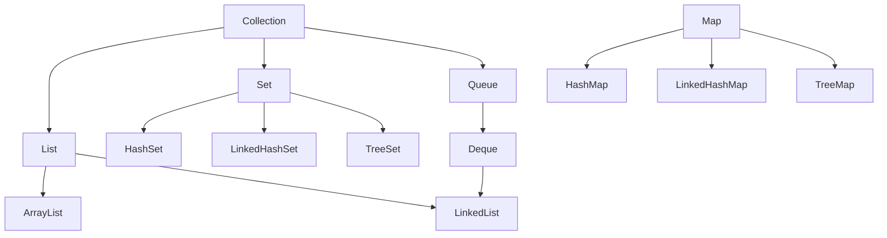

# Java

Course 15 of 15. Previous: [14-vitest.md](14-vitest.md).

Java is a statically typed language. You declare the type of every name. `javac` compiles a `.java` file to bytecode. `java` runs that bytecode on a JVM. This file keeps the chapters you asked to study: a program, strings, loops and arrays, methods, packages, inheritance, modifiers, nested types, `Scanner`, files and streams, and the collection classes.

Type every example in a file named after the public class, with autocomplete off. `public class Main` belongs in `Main.java`.

## Contents

1. [Program, syntax, output, comments](#1-program-syntax-output-comments)
2. [Strings and string methods](#2-strings-and-string-methods)
3. [Loops and arrays](#3-loops-and-arrays)
4. [Methods, parameters, scope, recursion](#4-methods-parameters-scope-recursion)
5. [Packages and the API](#5-packages-and-the-api)
6. [Inheritance, polymorphism, and super](#6-inheritance-polymorphism-and-super)
7. [Access modifiers and non-access modifiers](#7-access-modifiers-and-non-access-modifiers)
8. [Inner classes, abstraction, interfaces, anonymous classes, enums](#8-inner-classes-abstraction-interfaces-anonymous-classes-enums)
9. [Scanner](#9-scanner)
10. [Files: create, write, read, delete](#10-files-create-write-read-delete)
11. [I/O streams](#11-io-streams)
12. [Data structures](#12-data-structures)

## 1. Program, syntax, output, comments

A program starts at `main`. The file name must match the public class.

```java
public class Main {
    public static void main(String[] args) {
        System.out.print("Hello");
        System.out.print(" ");
        System.out.println("Java");
        System.out.printf("Price: %d%n", 999000);
    }
}
```

Save as `Main.java`. Compile and run:

```text
javac Main.java
java Main
```

| Piece | Meaning |
| --- | --- |
| `public class Main` | The class other code may use. One public class per file |
| `main` | The start method. The signature must match, including `String[] args` |
| `static` | The JVM can call it without building an object |
| `args` | Words typed after `java Main` |
| `{ }` | A block. Statements inside end with `;` |
| `// comment` | Ignored through the end of the line |
| `/* comment */` | Ignored across lines |

| Output method | Effect |
| --- | --- |
| `System.out.print(x)` | Write `x`. Stay on this line |
| `System.out.println(x)` | Write `x` and then a new line |
| `System.out.printf(fmt, args...)` | Formatted text. `%d` integer, `%f` float, `%s` string, `%n` newline |
| `System.err.println(x)` | The error stream, separate from normal output |

`printf` does not add a newline unless the format contains `%n`.

## 2. Strings and string methods

A `String` is an object. Methods return a new string. The original does not change.

```java
String city = "  Los Angeles  ";
String clean = city.trim();
System.out.println(clean.toLowerCase());
System.out.println(clean.substring(0, 3));
System.out.println("Irvine".equals(city));
System.out.println("Beds: " + 3);
```

`"Irvine" == city` asks whether both names point at the same object. `"Irvine".equals(city)` asks whether the characters match. Put the literal on the left so a null `city` does not throw.

| Method | Returns | What it does |
| --- | --- | --- |
| `length()` | `int` | Number of UTF-16 units |
| `charAt(i)` | `char` | The unit at `i`. Throws if `i` is out of range |
| `substring(start, end)` | `String` | From `start` inclusive to `end` exclusive |
| `indexOf(s)` | `int` | First index, or `-1` |
| `lastIndexOf(s)` | `int` | Last index, or `-1` |
| `contains(s)` | `boolean` | True if `s` occurs |
| `startsWith(s)` / `endsWith(s)` | `boolean` | Prefix or suffix |
| `toLowerCase()` / `toUpperCase()` | `String` | A new string |
| `trim()` | `String` | Strip characters at or below space from both ends |
| `strip()` | `String` | Strip Unicode whitespace. Prefer this in new code |
| `isEmpty()` | `boolean` | Length is 0 |
| `isBlank()` | `boolean` | Empty, or only whitespace |
| `equals(o)` | `boolean` | Same characters |
| `equalsIgnoreCase(s)` | `boolean` | Same letters, ignoring case |
| `compareTo(s)` | `int` | Negative, zero, or positive order |
| `concat(s)` | `String` | This string plus `s`. `+` is the usual way |
| `replace(old, next)` | `String` | Replace every match of a literal |
| `replaceAll(regex, next)` | `String` | Replace regex matches |
| `split(regex)` | `String[]` | Cut into pieces. `","` splits on commas |
| `join(delim, parts)` | `String` | Static. Glue pieces |
| `toCharArray()` | `char[]` | A copy of the units |
| `valueOf(x)` | `String` | Static. Turn a number or object into text |
| `format(fmt, args)` | `String` | Static. Same idea as `printf`, returns the string |
| `repeat(n)` | `String` | This string, `n` times |
| `matches(regex)` | `boolean` | The whole string matches the pattern |

`substring` and `charAt` throw `StringIndexOutOfBoundsException` when the index is illegal.

## 3. Loops and arrays

```java
int n = 3;
while (n > 0) {
    n--;
}

int m = 0;
do {
    m++;
} while (m < 3);

for (int i = 0; i < 3; i++) {
    if (i == 1) {
        continue;
    }
    System.out.println(i);
}
```

| Statement | When the body runs |
| --- | --- |
| `while` | While the test is true. Zero times if it starts false |
| `do` / `while` | Once, then again while the test is true |
| `for` | Init, then test, body, update, until the test fails |
| `for (Type item : items)` | Once per element of an array or an `Iterable` |
| `break` | Leave the nearest loop |
| `continue` | Skip the rest of this pass |

An array has a fixed length chosen at creation.

```java
int[] prices = new int[3];
prices[0] = 999000;
prices[1] = 1100000;
int first = prices[0];
int count = prices.length;

String[] cities = {"Irvine", "Tustin"};
System.out.println(java.util.Arrays.toString(cities));
```

Index `0` is first. `prices[3]` on a length-3 array throws `ArrayIndexOutOfBoundsException`. `length` is a field, not a method. New slots hold `0`, `false`, or `null`. You cannot grow the array. Copy it, or use a `List`.

| `Arrays` method | What it does |
| --- | --- |
| `toString(a)` | A readable one-line form |
| `deepToString(a)` | For arrays of arrays |
| `sort(a)` | Sort in place |
| `sort(a, from, to)` | Sort a range. `to` is excluded |
| `binarySearch(a, key)` | Index in a sorted array, or a negative insertion point |
| `copyOf(a, newLength)` | A new array, padded or truncated |
| `copyOfRange(a, from, to)` | A slice copy |
| `equals(a, b)` | Same length and equal elements |
| `fill(a, value)` | Set every slot |
| `asList(a, b, c)` | A fixed-size list backed by those elements |
| `stream(a)` | A stream over the array |

`int[][] grid = new int[2][3];` is an array of two arrays, each of length 3. Rows can later have different lengths.

## 4. Methods, parameters, scope, recursion

A method is a named block. Parameters are the inputs. The return type is what comes back. `void` means nothing usable comes back.

```java
static int clamp(int n, int min, int max) {
    if (n < min) {
        return min;
    }
    if (n > max) {
        return max;
    }
    return n;
}

static void printLabel(String city, int price) {
    System.out.println(city + ": " + price);
}
```

| Idea | Rule |
| --- | --- |
| Parameter | A local name filled in by the caller. `clamp(4, 0, 10)` binds `n`, `min`, and `max` |
| Pass by value | The primitive is copied. An object parameter copies the reference, so the method can change that object's fields and the caller sees it |
| Reassigning a parameter | Changes only the method's copy of the reference. The caller's variable still points at the old object |
| Overload | Same name, different parameter list. `printLabel(String)` and `printLabel(String, int)` are both legal. The return type alone cannot distinguish them |
| `return` | Leaves the method immediately |

Scope is where a name is visible.

| Scope | Visible |
| --- | --- |
| Block | From the declaration to the closing `}` of that `if`, loop, or method |
| Method parameter | The whole method |
| Field | The whole class, through `this` when a parameter hides it |
| `static` field | The class, with no object |
| Local in a `for` | Only that `for` |

A name in an inner block can hide an outer name. Do not do that on purpose. Two locals in sibling blocks may share a name because their scopes do not overlap.

Recursion is a method calling itself. It needs a base case, or the stack overflows.

```java
static int sumTo(int n) {
    if (n <= 0) {
        return 0;
    }
    return n + sumTo(n - 1);
}
```

`sumTo(3)` is `3 + sumTo(2)`, which is `3 + 2 + sumTo(1)`, which is `3 + 2 + 1 + sumTo(0)`, which is `6`.

## 5. Packages and the API

A package is a folder of related classes. The first line of the file names it, and it must match the directory.

```java
package realty;

import java.util.ArrayList;
import java.time.LocalDate;
```

| Piece | Meaning |
| --- | --- |
| `package realty;` | This class lives in `realty`. The file is `realty/Listing.java` |
| `import java.util.ArrayList;` | Use the simple name `ArrayList` |
| `import java.util.*;` | Every type in that package. Prefer explicit imports |
| Fully qualified name | `java.util.ArrayList` with no import |
| `java.lang` | Imported for you. `String`, `Math`, `System`, `Integer` |

The API is the set of classes the JDK ships. You do not copy them into your project. You import them.

| Package | What you take from it |
| --- | --- |
| `java.lang` | `String`, `Math`, `System`, `Integer` |
| `java.util` | Collections, `Scanner`, `Objects`, `Optional` |
| `java.io` | `File`, streams, readers, writers |
| `java.nio.file` | `Path` and `Files`, a newer file API |
| `java.time` | `LocalDate`, `LocalDateTime`, `DateTimeFormatter` |
| `java.util.regex` | `Pattern`, `Matcher` |

Classes in the same package see each other's package-private members. Classes in another package see only `public` members, and `protected` members if they extend the class.

## 6. Inheritance, polymorphism, and super

A class may extend one parent. The child is the parent type, plus its own fields.

```java
public class Condo extends Listing {
    private final int hoa;

    public Condo(String id, String city, int price, int hoa) {
        super(id, city, price);
        this.hoa = hoa;
    }

    public int getHoa() {
        return hoa;
    }

    @Override
    public String getCity() {
        return super.getCity() + " (condo)";
    }
}
```

| Word | Meaning |
| --- | --- |
| `extends` | One parent class |
| `super(...)` | Call the parent constructor. First line of the child constructor |
| `super.getCity()` | The parent's method, even if this class replaced it |
| `@Override` | Ask the compiler to check that a parent method really has this signature |

Polymorphism: the variable's type is what the compiler checks. The object's type is which method runs.

```java
Listing home = new Condo("R1", "Irvine", 999000, 350);
System.out.println(home.getCity());
System.out.println(home instanceof Condo);
```

`home.getHoa()` does not compile, because `Listing` has no `getHoa`. `home instanceof Condo` is true. `((Condo) home).getHoa()` works. The cast throws `ClassCastException` if the object is not a `Condo`.

Every class extends `Object` if you do not write another parent. `toString`, `equals`, and `hashCode` come from there. Replace `equals` and `hashCode` together, or hash-based collections break.

## 7. Access modifiers and non-access modifiers

An access modifier decides who may use a class, field, method, or constructor. A non-access modifier decides how that member behaves. You can write one access modifier and several non-access modifiers on the same declaration: `public static final int CAP = 10;`.

```java
public class Listing {
    private String city;
    int beds;
    protected int price;
    public static int count;
    public final int id;

    public Listing(int id, String city) {
        this.id = id;
        this.city = city;
        count++;
    }

    public String getCity() {
        return city;
    }

    protected int getPrice() {
        return price;
    }

    void touch() {
        beds++;
    }
}
```

`city` is visible only inside `Listing`. `beds` and `touch` are package-private: same package, no keyword. `price` and `getPrice` are also visible to a subclass in another package. `getCity`, `count`, and `id` are visible everywhere this class is visible.

### Access modifiers

| Modifier | Same class | Same package | Subclass in another package | Everywhere else |
| --- | --- | --- | --- | --- |
| `private` | Yes | No | No | No |
| none (package-private) | Yes | Yes | No | No |
| `protected` | Yes | Yes | Yes | No |
| `public` | Yes | Yes | Yes | Yes |

A subclass in the same package can see package-private members because of the package, not because of inheritance. `protected` is what adds the subclass in a different package. From that other package, the subclass may use the `protected` member on its own type, not on some other object's parent type.

| Can be written on | Top-level class | Nested class | Field | Method | Constructor |
| --- | --- | --- | --- | --- | --- |
| `public` | Yes | Yes | Yes | Yes | Yes |
| `protected` | No | Yes | Yes | Yes | Yes |
| none | Yes | Yes | Yes | Yes | Yes |
| `private` | No | Yes | Yes | Yes | Yes |

A top-level class is `public` or package-private. The file name matches the `public` class. One file has one `public` top-level class.

### Non-access modifiers

| Modifier | Class | Field | Method | Local variable | What it changes |
| --- | --- | --- | --- | --- | --- |
| `final` | No subclasses | Assign once. A blank `final` field is set in every constructor | No override | Assign once | The binding does not change |
| `static` | Nested class only. No outer object | One copy shared by the class | Call on the class: `Listing.count` | No | Belongs to the class, not one object |
| `abstract` | Cannot `new` it | No | No body. A child supplies the body | No | A promise, filled in by a subclass |
| `transient` | No | Skipped by Java serialization | No | No | The field is not stored with the object |
| `volatile` | No | A write is visible to other threads | No | No | Threads do not keep a private stale copy |
| `synchronized` | No | No | Only one thread runs that method on the same object at a time | No | The lock is the object, or the `Class` if the method is `static` |
| `native` | No | No | The body is written in another language | No | Java only declares the signature |
| `strictfp` | Yes | No | Yes | No | Older Java. Current Java already uses strict floating point, so this word changes nothing |

`final` does not freeze an object. `final List<String> cities = new ArrayList<>();` still allows `cities.add(...)`. It forbids `cities = someOtherList`.

If one method is `abstract`, the class is `abstract`. A concrete subclass implements every abstract method, or it stays `abstract` too. An interface method is `public` and `abstract` unless it is `default`, `static`, or `private`.

`static` and `abstract` do not go together on a method. A `static` method belongs to the class, so there is no object for a subclass to override. `final` and `abstract` do not go together either: one forbids an override, the other requires one.

## 8. Inner classes, abstraction, interfaces, anonymous classes, enums

An inner class is nested inside another class. A non-static inner class holds a hidden reference to the outer object.

```java
public class Listing {
    private String city;

    public class Note {
        private String text;

        public Note(String text) {
            this.text = text;
        }

        public String line() {
            return Listing.this.city + ": " + text;
        }
    }
}
```

`Listing.this.city` is the outer field when `this.city` would be ambiguous. `new home.Note("pool")` builds a note tied to that home. A `static` nested class does not hold the outer object. Use that when the nested class does not need the parent's fields.

An abstract class cannot be constructed. A child must implement its abstract methods.

```java
public abstract class Report {
    public abstract String title();

    public String header() {
        return "Report: " + title();
    }
}
```

An interface is a list of methods a class promises. A class can implement several interfaces and extend only one class.

```java
public interface Priced {
    int getPrice();
}

public class Listing implements Priced {
    private int price;

    @Override
    public int getPrice() {
        return price;
    }
}
```

Interface methods are public. A newer interface may contain a `default` method with a body. Fields in an interface are `public static final`.

An anonymous class is a one-off subclass with no name.

```java
Priced sample = new Priced() {
    @Override
    public int getPrice() {
        return 1;
    }
};
```

An enum is a fixed set of constants.

```java
public enum Status {
    PENDING,
    APPROVED,
    REJECTED
}
```

| Enum tool | Use |
| --- | --- |
| `Status.APPROVED` | One constant |
| `status.name()` | `"APPROVED"` |
| `Status.valueOf("APPROVED")` | The constant. Throws if the text is wrong |
| `Status.values()` | Every constant, in declaration order |
| `switch (status)` | A case per constant. The compiler can warn if one is missing |

## 9. Scanner

`Scanner` reads tokens from the keyboard, a string, or a file. Import it from `java.util`.

```java
import java.util.Scanner;

Scanner in = new Scanner(System.in);
System.out.print("City: ");
String city = in.nextLine();
System.out.print("Beds: ");
int beds = in.nextInt();
in.nextLine();
```

`nextInt` reads the number and leaves the newline sitting in the input. The next `nextLine` then returns an empty string. Call `nextLine` once to throw that newline away before you read a real line.

| Method | What it reads |
| --- | --- |
| `next()` | The next token. Stops at whitespace |
| `nextLine()` | The rest of the line, spaces included, newline not included |
| `nextInt()` | One `int` token |
| `nextLong()` / `nextDouble()` / `nextBoolean()` | One token of that type |
| `hasNext()` | True when another token is waiting |
| `hasNextInt()` / `hasNextLine()` | True when the next token or line has that shape |
| `close()` | Releases the source |

| Mistake | What happens |
| --- | --- |
| `nextLine` right after `nextInt` | You get `""` unless you drain the leftover newline |
| `nextInt` on a word | `InputMismatchException`. Check with `hasNextInt` first |
| `next` when you wanted a full city name | `"Los Angeles"` becomes only `"Los"` |
| `close()` on a `Scanner` around `System.in` | Later keyboard reads in the same program fail |
| `==` on two strings from input | Compares identity. Use `equals` |

## 10. Files: create, write, read, delete

`java.io.File` names a path and can create or delete it. It does not, by itself, write the characters. A `FileWriter` writes text. A `Scanner` can read it back.

```java
import java.io.File;
import java.io.FileWriter;
import java.io.IOException;
import java.util.Scanner;

File note = new File("notes.txt");
if (note.createNewFile()) {
    System.out.println("created " + note.getName());
}
try (FileWriter writer = new FileWriter(note)) {
    writer.write("Irvine\n");
}
try (Scanner reader = new Scanner(note)) {
    while (reader.hasNextLine()) {
        System.out.println(reader.nextLine());
    }
}
if (note.delete()) {
    System.out.println("deleted");
}
```

`createNewFile` returns false when the file already exists. It does not erase the contents. `new FileWriter(note)` overwrites. `new FileWriter(note, true)` appends. `delete` returns false when the file is missing or a non-empty directory cannot be removed. These methods throw the checked `IOException`, so the method must catch it or declare `throws IOException`.

| `File` method | Returns | What it does |
| --- | --- | --- |
| `createNewFile()` | `boolean` | Create an empty file. False if it already exists |
| `delete()` | `boolean` | Delete the file or an empty directory |
| `exists()` | `boolean` | The path is present |
| `canRead()` / `canWrite()` | `boolean` | Whether this process may read or write |
| `getName()` | `String` | The last part of the path |
| `getAbsolutePath()` | `String` | The path from the root |
| `getParent()` | `String` | The directory portion, or null |
| `length()` | `long` | Size in bytes. `0` if the file does not exist |
| `isFile()` / `isDirectory()` | `boolean` | What the path points at |
| `list()` | `String[]` | Names inside a directory, or null if this is not a directory |
| `mkdir()` | `boolean` | Create one directory. The parent must exist |
| `mkdirs()` | `boolean` | Create the directory and any missing parents |
| `renameTo(dest)` | `boolean` | Move or rename. Not reliable across filesystems |
| `lastModified()` | `long` | Milliseconds since the epoch |

`FileWriter` methods used above: `write(String)` and `close()`. Closing flushes the buffered characters. The try-with-resources block closes it.

`java.nio.file` is the newer API for the same jobs:

```java
import java.nio.file.Files;
import java.nio.file.Path;

Path path = Path.of("notes.txt");
Files.writeString(path, "Irvine\n");
String text = Files.readString(path);
Files.deleteIfExists(path);
```

Learn `File` because that is the menu in the beginner track. `Path` and `Files` are what new application code should call.

## 11. I/O streams

A stream is a sequence of bytes or characters. Byte streams move raw bytes. Character streams move text and handle the charset.

| Class | Moves | Direction |
| --- | --- | --- |
| `FileInputStream` | bytes | file to program |
| `FileOutputStream` | bytes | program to file |
| `FileReader` / `FileWriter` | characters | text file |
| `InputStreamReader` | bytes to characters | wraps a byte stream |
| `BufferedReader` | characters, a line at a time | wraps a reader |
| `BufferedWriter` | characters, flushed in chunks | wraps a writer |

Buffering matters because reading one byte at a time from a disk is slow. The buffer reads a block and hands it to you in pieces.

```java
import java.io.BufferedReader;
import java.io.BufferedWriter;
import java.io.FileInputStream;
import java.io.FileOutputStream;
import java.io.InputStreamReader;
import java.io.OutputStreamWriter;
import java.nio.charset.StandardCharsets;

try (FileOutputStream out = new FileOutputStream("notes.txt");
     OutputStreamWriter encoder = new OutputStreamWriter(out, StandardCharsets.UTF_8);
     BufferedWriter writer = new BufferedWriter(encoder)) {
    writer.write("Irvine");
    writer.newLine();
}

try (FileInputStream in = new FileInputStream("notes.txt");
     InputStreamReader decoder = new InputStreamReader(in, StandardCharsets.UTF_8);
     BufferedReader reader = new BufferedReader(decoder)) {
    String line;
    while ((line = reader.readLine()) != null) {
        System.out.println(line);
    }
}
```

The assignment inside `while ((line = reader.readLine()) != null)` both reads and tests. `readLine` returns `null` at the end of the file. It strips the newline.

| `FileInputStream` | What it does |
| --- | --- |
| `read()` | The next byte as `0`–`255`, or `-1` at the end |
| `read(byte[] buf)` | Fill the array. Returns how many bytes were read, or `-1` |
| `available()` | An estimate of bytes that can be read without blocking |
| `skip(n)` | Skip ahead |
| `close()` | Release the file |

| `FileOutputStream` | What it does |
| --- | --- |
| `write(int b)` | Write the low 8 bits |
| `write(byte[] buf)` | Write the whole array |
| `write(byte[] buf, off, len)` | Write a slice |
| `flush()` | Push buffered bytes. Byte streams are often unbuffered until you wrap them |
| `close()` | Flush and release |
| constructor `(path, true)` | Append instead of overwrite |

| `BufferedReader` | What it does |
| --- | --- |
| `readLine()` | One line without the newline, or `null` |
| `read()` | One character as an `int`, or `-1` |
| `ready()` | True if a read is unlikely to block |
| `close()` | Close this reader and the stream under it |

| `BufferedWriter` | What it does |
| --- | --- |
| `write(String)` | Queue characters |
| `newLine()` | The platform line separator |
| `flush()` | Push the buffer down to the file |
| `close()` | Flush, then close |

Always close from the outside. Try-with-resources on the outermost wrapper closes the inner streams too. Name `UTF-8` explicitly. The platform default charset is a way to write a file on one machine and misread it on another.

## 12. Data structures

A collection holds many elements. The interface says which methods exist. The class says how those methods are stored and how fast they are. `Map` is not a `Collection`. It stores pairs, not single elements.

`java.util.Collection` is the interface. `java.util.Collections` is the class of static algorithms. The names differ by one letter.



| | Duplicates | Order you can rely on | Index | Typical class |
| --- | --- | --- | --- | --- |
| `List` | Yes | Index order | Yes | `ArrayList`, `LinkedList` |
| `Set` | No | Depends on the class | No | `HashSet`, `LinkedHashSet`, `TreeSet` |
| `Deque` | Yes | The two ends | No | `LinkedList`, `ArrayDeque` |
| `Map` | Unique keys | Depends on the class | No | `HashMap`, `LinkedHashMap`, `TreeMap` |

Program to the interface when the method does not care which class it is: `List<String> names = new ArrayList<>();`. The type argument must be a class, so you write `List<Integer>`, not `List<int>`.

### Methods `List` and `Set` share

These come from `Collection`. A `Map` does not have them.

| Method | On a `List` | On a `Set` |
| --- | --- | --- |
| `add(item)` | Appends. Returns `true` | Inserts. Returns `false` if an equal item is already there |
| `remove(item)` | Removes the first equal item | Removes the equal item |
| `contains(item)` | Walks until `equals` hits | `HashSet` is usually immediate. `TreeSet` walks the tree |
| `size()` / `isEmpty()` / `clear()` | Count, test, empty | Same |
| `addAll(other)` | Appends every element | Union into this set |
| `removeAll(other)` | Drops every element that is also in `other` | Same |
| `retainAll(other)` | Keeps only elements that are also in `other` | Intersection |
| `containsAll(other)` | True if every element of `other` is here | Same |
| `iterator()` | Walks index order | Walks in the set's order |
| `toArray()` | A new array of the elements | Same |

`contains` uses `equals`. Two objects that are `equals` must return the same `hashCode`, or a `HashSet` and a `HashMap` can miss one of them.

### `List`, `ArrayList`, and `LinkedList`

`List` is an ordered sequence with indexes. `get` throws `IndexOutOfBoundsException` when the index is bad.

```java
import java.util.ArrayList;
import java.util.List;

List<String> cities = new ArrayList<>();
cities.add("Irvine");
cities.add("Tustin");
cities.add(0, "Anaheim");
String first = cities.get(0);
cities.set(0, "Anaheim");
cities.remove("Tustin");
```

`ArrayList` is a growable array. `get` and `set` jump to the index. Inserting or removing near the front shifts every later item.

`LinkedList` is a chain of nodes. Each node points at the next and the previous. `get(i)` walks from the nearer end. Adding or removing at an end does not shift the other nodes. It is also a `Deque`, so it has the end methods an `ArrayList` does not.

| Method | `ArrayList` | `LinkedList` |
| --- | --- | --- |
| `add(item)` | Append | Append |
| `add(index, item)` | Shift later items right | Walk to `index`, then link a node |
| `get(index)` / `set(index, item)` | Direct | Walk from the nearer end. `set` returns the old value |
| `remove(index)` | Shift later items left. Returns the removed item | Walk, then unlink. Returns the removed item |
| `remove(item)` | First `equals` match | First `equals` match |
| `indexOf` / `lastIndexOf` | Index, or `-1` | Index, or `-1` |
| `subList(from, to)` | A view. `to` is excluded. Edits show up in the original | Same |
| `sort(comparator)` | Sort this list | Sort this list |
| `ensureCapacity(n)` / `trimToSize()` | Yes. Room for later `add`, then drop unused slots | No |
| `addFirst` / `addLast` | Yes since Java 21, on every `List` | Yes. Also the older `Deque` methods |
| `getFirst` / `getLast` | Yes since Java 21. Throw if empty | Yes. Throw if empty |
| `removeFirst` / `removeLast` | Yes since Java 21. Throw if empty | Yes. Throw if empty |
| `peek` / `peekFirst` / `peekLast` | No | Read an end, or `null` if empty |
| `poll` / `pollFirst` / `pollLast` | No | Remove an end, or `null` if empty |
| `offer` / `offerFirst` / `offerLast` | No | Add, and return whether it was accepted |
| `push` / `pop` | No | Stack names. `push` is `addFirst`. `pop` is `removeFirst` |
| `descendingIterator()` | No | Walk from the tail |

```java
import java.util.LinkedList;

LinkedList<String> line = new LinkedList<>();
line.addLast("a");
line.addLast("b");
line.addFirst("z");
String next = line.removeFirst();
```

| You need | Pick |
| --- | --- |
| Random `get` by index | `ArrayList` |
| Inserts and removals at the ends, plus a list | `LinkedList` |
| A queue and nothing else | `ArrayDeque` |

`List.of("Irvine", "Tustin")` is fixed. `add` throws. `List.copyOf(cities)` is a fixed copy.

On a `List<Integer>`, `remove(3)` removes index 3. `remove(Integer.valueOf(3))` removes the value 3. The `int` overload wins when you pass a bare number.

### List sorting

Natural order for strings is alphabetical. For `Integer` it is numeric. Your own class implements `Comparable`, or you pass a `Comparator`.

```java
import java.util.ArrayList;
import java.util.Collections;
import java.util.Comparator;
import java.util.List;

List<String> cities = new ArrayList<>(List.of("Tustin", "Anaheim", "Irvine"));
Collections.sort(cities);
cities.sort(Comparator.reverseOrder());
Collections.reverse(cities);
Collections.shuffle(cities);
int at = Collections.binarySearch(cities, "Irvine");
```

| Call | What it sorts by |
| --- | --- |
| `Collections.sort(list)` | Natural order, in place |
| `Collections.sort(list, comparator)` | The comparator, in place |
| `list.sort(comparator)` | The same sort, as a method on the list |
| `Comparator.naturalOrder()` | The element's own order |
| `Comparator.reverseOrder()` | That order flipped |
| `Comparator.comparing(fn)` | The value `fn` extracts |

`binarySearch` needs the list sorted in the same order the search uses. A negative result means the item is absent. The insertion point is `-(result) - 1`.

### `Set`, `HashSet`, `TreeSet`, and `LinkedHashSet`

A `Set` refuses duplicates. There is no `get(index)`.

```java
import java.util.HashSet;
import java.util.Set;

Set<String> cities = new HashSet<>();
cities.add("Irvine");
boolean second = cities.add("Irvine");
boolean seen = cities.contains("Irvine");
cities.remove("Irvine");
```

`second` is `false` because the set already held `"Irvine"`.

The shared methods are the `Collection` rows above. What changes is order, null, and the extra methods on `TreeSet`.

| | `HashSet` | `LinkedHashSet` | `TreeSet` |
| --- | --- | --- | --- |
| Order | None you can rely on | Insertion order | Sorted |
| Null element | One | One | None, when the order is natural |
| Your class must provide | `equals` and `hashCode` together | The same | `Comparable`, or a `Comparator` in the constructor |
| `add` of a duplicate | Returns `false` | Returns `false` | Returns `false` |
| `first()` / `last()` | No | No | Ends of the sort. Throw if empty |
| `lower(x)` / `higher(x)` | No | No | Strictly before or after `x`, or `null` |
| `floor(x)` / `ceiling(x)` | No | No | At most `x`, or at least `x`, or `null` |
| `headSet(to)` / `tailSet(from)` / `subSet(from, to)` | No | No | Views. `subSet` excludes `to` |
| `pollFirst()` / `pollLast()` | No | No | Remove an end, or `null` if empty |

```java
import java.util.LinkedHashSet;
import java.util.TreeSet;

LinkedHashSet<String> inserted = new LinkedHashSet<>();
inserted.add("Tustin");
inserted.add("Irvine");
// walks as Tustin, then Irvine

TreeSet<String> sorted = new TreeSet<>();
sorted.add("Tustin");
sorted.add("Irvine");
// walks as Irvine, then Tustin
String low = sorted.first();
String high = sorted.last();
```

### `Map`, `HashMap`, `TreeMap`, and `LinkedHashMap`

A `Map` stores one value under each key. The second `put` for the same key replaces the value and returns the old one.

```java
import java.util.HashMap;
import java.util.Map;

Map<String, Integer> budget = new HashMap<>();
budget.put("Irvine", 1_500_000);
budget.put("Irvine", 1_200_000);
int known = budget.get("Irvine");
int missing = budget.getOrDefault("Temecula", 0);
budget.remove("Irvine");
```

`get` returns `null` when the key is absent. Assigning that `null` to an `int` throws `NullPointerException`. Use `getOrDefault`, or test `containsKey` first.

| Method | What it does | `HashMap` | `LinkedHashMap` | `TreeMap` |
| --- | --- | --- | --- | --- |
| `put(key, value)` | Insert or replace. Returns the previous value, or `null` | Yes | Yes | Yes |
| `putIfAbsent(key, value)` | Insert only when the key is missing or mapped to `null` | Yes | Yes | Yes |
| `putAll(other)` | Copy every entry | Yes | Yes | Yes |
| `get(key)` | The value, or `null` | Yes | Yes | Yes |
| `getOrDefault(key, fallback)` | The value, or `fallback` | Yes | Yes | Yes |
| `containsKey` / `containsValue` | Boolean. The value scan walks every entry | Yes | Yes | Yes |
| `remove(key)` | Remove and return the old value | Yes | Yes | Yes |
| `remove(key, value)` | Remove only when the value matches too | Yes | Yes | Yes |
| `replace(key, value)` | Replace only when the key exists | Yes | Yes | Yes |
| `computeIfAbsent(key, fn)` | Build a value when the key is missing | Yes | Yes | Yes |
| `merge(key, value, remapper)` | Combine with an existing value | Yes | Yes | Yes |
| `keySet()` / `values()` / `entrySet()` | Views. Removing from the view removes the entry | Yes | Yes | Yes |
| `forEach((k, v) -> ...)` | Visit every pair | Yes | Yes | Yes |
| `size()` / `isEmpty()` / `clear()` | Count, test, empty | Yes | Yes | Yes |
| Key order | | None you can rely on | Insertion order | Sorted |
| Null key | | One | One | None, when the order is natural |
| `firstKey()` / `lastKey()` | Ends of the key order. Throw if empty | No | No | Yes |
| `lowerKey` / `higherKey` | Strictly before or after, or `null` | No | No | Yes |
| `floorKey` / `ceilingKey` | At most, or at least, or `null` | No | No | Yes |
| `headMap` / `tailMap` / `subMap` | Views of a key range. `subMap` excludes the end | No | No | Yes |

The `TreeSet` and `TreeMap` range methods match:

| Idea | `TreeSet` | `TreeMap` |
| --- | --- | --- |
| Lowest / highest | `first()` / `last()` | `firstKey()` / `lastKey()` |
| Strictly before / after | `lower(x)` / `higher(x)` | `lowerKey(k)` / `higherKey(k)` |
| At most / at least | `floor(x)` / `ceiling(x)` | `floorKey(k)` / `ceilingKey(k)` |
| Below / from | `headSet(to)` / `tailSet(from)` | `headMap(to)` / `tailMap(from)` |
| A range | `subSet(from, to)` | `subMap(from, to)` |

```java
import java.util.LinkedHashMap;
import java.util.TreeMap;

LinkedHashMap<String, Integer> byInsert = new LinkedHashMap<>();
byInsert.put("Tustin", 1);
byInsert.put("Irvine", 2);
// key walk: Tustin, Irvine

TreeMap<String, Integer> byName = new TreeMap<>();
byName.put("Tustin", 1);
byName.put("Irvine", 2);
// key walk: Irvine, Tustin
```

Walk pairs through the entry set:

```java
for (Map.Entry<String, Integer> entry : budget.entrySet()) {
    System.out.println(entry.getKey() + " " + entry.getValue());
}
```

`Map.of("Irvine", 1)` is a fixed map. It rejects a null key, a null value, and a duplicate key. `Map.copyOf(budget)` is a fixed copy.

### `Iterator`

An `Iterator` walks a collection and can remove the current item. A for-each loop cannot remove safely. Removing inside for-each throws `ConcurrentModificationException`.

```java
import java.util.Iterator;

Iterator<String> it = cities.iterator();
while (it.hasNext()) {
    String city = it.next();
    if (city.isBlank()) {
        it.remove();
    }
}
```

| Method | `Iterator` | `ListIterator` |
| --- | --- | --- |
| `hasNext()` | True if `next` would return an element | Same |
| `next()` | The next element. Throws `NoSuchElementException` if none remain | Same, moving forward |
| `remove()` | Removes the element just returned. Once per `next` | Same, after `next` or `previous` |
| `forEachRemaining(action)` | Runs the action on every element still ahead | Same |
| `hasPrevious()` / `previous()` | No | Walk backward |
| `nextIndex()` / `previousIndex()` | No | The index a move would land on |
| `add(item)` | No | Inserts before the next forward element |
| `set(item)` | No | Replaces the element just returned |

`cities.listIterator()` is the two-way cursor. `LinkedList.descendingIterator()` walks from the tail and only has the `Iterator` methods.

### Algorithms

`Collections` is the static algorithm class. These calls change the list you pass, except the search and the factory methods.

| Method | What it does |
| --- | --- |
| `sort(list)` | Natural order |
| `sort(list, comparator)` | The order you supply |
| `reverse(list)` | Flip the current order |
| `shuffle(list)` | Random order |
| `swap(list, i, j)` | Exchange two indexes |
| `fill(list, value)` | Replace every element |
| `copy(dest, src)` | Copy into a dest that is already long enough |
| `min(list)` / `max(list)` | Smallest or largest by natural order |
| `frequency(list, item)` | How many elements `equals` the item |
| `binarySearch(list, key)` | Index in a sorted list, or a negative insertion point |
| `disjoint(a, b)` | True if the two collections share no element |
| `addAll(collection, a, b)` | Add those elements |
| `indexOfSubList(list, part)` | Where `part` starts, or `-1` |
| `unmodifiableList(list)` | A view that rejects writes |
| `emptyList()` | A shared empty list |
| `singletonList(item)` | A fixed list of one item |
| `nCopies(n, item)` | An immutable list of `n` copies of the same reference |

`List.sort` and `Collections.sort` both sort in place. `Collections.sort` is the older call. `List.sort` is the method on the list.

## Drill

Write these without looking.

1. `sumTo` from the methods section, and say what the base case is.
2. Read a city with `nextLine` and a bed count with `nextInt`, and say why a second `nextLine` is required before another city.
3. Create `notes.txt` with `File` and `FileWriter`, read it with `BufferedReader`, then `delete` it.
4. Put the same three cities in an `ArrayList`, a `LinkedHashSet`, and a `TreeMap`, and say which method exists on the `TreeMap` that the other two do not have.
5. For `private`, package-private, `protected`, and `public`, say which of the four places can see each one: the same class, the same package, a subclass in another package, and everywhere else.
