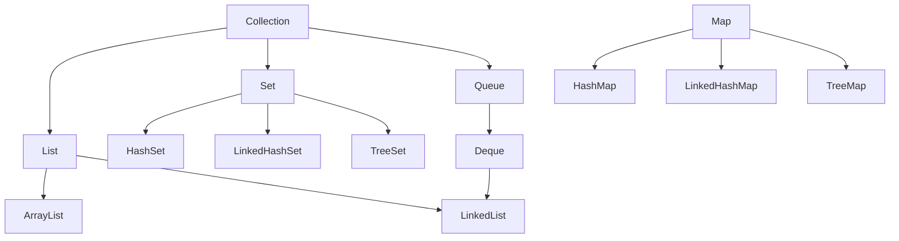

# Java

Course 15 of 15. Previous: [14-vitest.md](14-vitest.md).

Java is a statically typed language. You declare the type of every name. `javac` compiles a `.java` file to bytecode. `java` runs that bytecode on a JVM.

This file keeps the chapters you asked to study: a program, strings, loops and arrays, methods, packages, inheritance, modifiers, nested types, `Scanner`, files and streams, and the collection classes. Lambdas and threads are not in this course.

Examples assume Java 21. Type each example in a file named after the public class, with autocomplete off. `public class Main` belongs in `Main.java`.

Every section below has the same parts: the concept, the terms, the methods, several cases with the result, common mistakes, a tip, and a practice with a solution.

## Contents

1. [Program, syntax, output, comments](#1-program-syntax-output-comments)
2. [Strings and string methods](#2-strings-and-string-methods)
3. [Loops and arrays](#3-loops-and-arrays)
4. [Methods, parameters, scope, recursion](#4-methods-parameters-scope-recursion)
5. [Packages and the API](#5-packages-and-the-api)
6. [Inheritance, polymorphism, and super](#6-inheritance-polymorphism-and-super)
7. [Access modifiers and non-access modifiers](#7-access-modifiers-and-non-access-modifiers)
8. [Inner classes, abstraction, interfaces, anonymous classes, enums](#8-inner-classes-abstraction-interfaces-anonymous-classes-enums)
9. [Scanner](#9-scanner)
10. [Files: create, write, read, delete](#10-files-create-write-read-delete)
11. [I/O streams](#11-io-streams)
12. [Data structures](#12-data-structures)

## 1. Program, syntax, output, comments

### Concept

A program starts at `main`. The file name must match the public class. Statements end with `;`. Braces group statements into a block. Comments are for the reader. The compiler ignores them, so a comment cannot fix a bug or print text.

### Terms

| Piece | Meaning |
| --- | --- |
| `public class Main` | The class other code may use. One public class per file, and the file is `Main.java` |
| `main` | The start method. The signature must match, including `String[] args` |
| `static` | The JVM can call it without building an object |
| `args` | The words typed after `java Main` |
| `{ }` | A block |
| `// comment` | Ignored through the end of the line |
| `/* comment */` | Ignored across lines |

### Methods

| Method | Effect |
| --- | --- |
| `System.out.print(x)` | Write `x`. Stay on this line |
| `System.out.println(x)` | Write `x` and then a new line |
| `System.out.println()` | Write only a new line |
| `System.out.printf(fmt, args...)` | Formatted text. `%d` integer, `%s` string, `%f` floating point, `%n` newline |
| `System.err.println(x)` | The error stream, separate from normal output |

### Examples

**Case: `print` stays on the line, `println` ends it**

```java
public class Main {
    public static void main(String[] args) {
        System.out.print("Hello");
        System.out.print(" ");
        System.out.println("Java");
    }
}
```

Result:

```text
Hello Java
```

Why: the two `print` calls write `Hello` and a space with no line break. `println` writes `Java` and then ends the line.

**Case: `printf` needs `%n` for a new line**

```java
public class Main {
    public static void main(String[] args) {
        System.out.printf("Price: %d", 999000);
        System.out.printf(" next");
        System.out.printf("%nBeds: %d%n", 3);
    }
}
```

Result:

```text
Price: 999000 next
Beds: 3
```

Why: the first two formats contain no `%n`, so ` next` continues the same line. `%n` is the newline token inside the format string.

**Case: `args` are the words after the class name**

```java
public class Main {
    public static void main(String[] args) {
        System.out.println(args.length);
        System.out.println(args[0]);
    }
}
```

Command: `java Main Irvine 3`

Result:

```text
2
Irvine
```

Why: `java` itself is not an argument. `Main` is the class. `Irvine` and `3` are `args[0]` and `args[1]`. Both are strings. `3` is not an `int` until you parse it.

**Case: a comment does not run**

```java
public class Main {
    public static void main(String[] args) {
        System.out.println("shown");
        // System.out.println("hidden");
        /* System.out.println("also hidden"); */
    }
}
```

Result:

```text
shown
```

Why: both comment forms are removed before the program runs.

**Case: the file name and the public class disagree**

```java
public class Main {
    public static void main(String[] args) {
        System.out.println("hi");
    }
}
```

Saved as `Listing.java`.

Result: does not compile. The public class `Main` must live in `Main.java`.

Why: the compiler uses the public class name as the file name. A package-private class may use another file name. A public one may not.

### Common mistakes

| Mistake | What happens | Fix |
| --- | --- | --- |
| `main` is not `static`, or the parameter is not `String[]` | `java Main` does not start the program | Use `public static void main(String[] args)` |
| `printf` with no `%n`, then you look for a new line | The next output stays on the same line | Put `%n` in the format, or call `println` |
| A missing `;` or a missing `}` | The compiler points at the next line, which is often not the real mistake | Check the previous line |
| Code written after `//` | That line never runs | Delete the `//` |

### Tip

Read the first compiler error only. Later errors are often the same missing brace reported again.

### Practice

Write a program that prints your city on one line and the number of bedrooms on the next, using `printf` for the number. The bedroom line must end.

### Solution

```java
public class Main {
    public static void main(String[] args) {
        System.out.println("Irvine");
        System.out.printf("Beds: %d%n", 3);
    }
}
```

Result:

```text
Irvine
Beds: 3
```

## 2. Strings and string methods

### Concept

A `String` is an object that holds text. Methods return a new string. The original does not change. Indexes start at 0. `substring(start, end)` includes `start` and stops before `end`. `equals` compares characters. `==` compares whether two names point at the same object.

### Terms

| Term | Meaning |
| --- | --- |
| Immutable | Methods do not edit the characters in place. They return a new `String` |
| Index | The position of a UTF-16 unit. The first is 0 |
| Empty | `length()` is 0 |
| Blank | Empty, or only whitespace |
| Interned literal | `"Irvine"` written twice in source may be the same object. That does not make `==` a character test |

### Methods

| Method | Returns | What it does |
| --- | --- | --- |
| `length()` | `int` | Number of UTF-16 units |
| `charAt(i)` | `char` | The unit at `i`. Throws if `i` is out of range |
| `substring(start, end)` | `String` | From `start` inclusive to `end` exclusive |
| `substring(start)` | `String` | From `start` through the end |
| `indexOf(s)` | `int` | First index, or `-1` |
| `lastIndexOf(s)` | `int` | Last index, or `-1` |
| `contains(s)` | `boolean` | True if `s` occurs |
| `startsWith(s)` / `endsWith(s)` | `boolean` | Prefix or suffix |
| `toLowerCase()` / `toUpperCase()` | `String` | A new string |
| `trim()` | `String` | Strip characters at or below the space character from both ends |
| `strip()` | `String` | Strip Unicode whitespace. Prefer this in new code |
| `isEmpty()` | `boolean` | Length is 0 |
| `isBlank()` | `boolean` | Empty, or only whitespace |
| `equals(o)` | `boolean` | Same characters. `null` on the receiver throws |
| `equalsIgnoreCase(s)` | `boolean` | Same letters, ignoring case |
| `compareTo(s)` | `int` | Negative, zero, or positive order |
| `concat(s)` | `String` | This string plus `s`. `+` is the usual way |
| `replace(old, next)` | `String` | Replace every match of a literal |
| `replaceAll(regex, next)` | `String` | Replace regex matches. `.` means any character |
| `split(regex)` | `String[]` | Cut into pieces. Trailing empty pieces are dropped |
| `split(regex, limit)` | `String[]` | A negative limit keeps trailing empty pieces |
| `join(delim, parts)` | `String` | Static. Glue pieces |
| `valueOf(x)` | `String` | Static. Turn a number or object into text |
| `repeat(n)` | `String` | This string, `n` times |
| `matches(regex)` | `boolean` | The whole string matches the pattern |

### Examples

**Case: a method returns a new string**

```java
public class Main {
    public static void main(String[] args) {
        String city = "  Los Angeles  ";
        String clean = city.trim();
        System.out.println(city);
        System.out.println(clean);
        System.out.println(clean.toLowerCase());
        System.out.println(clean.substring(0, 3));
    }
}
```

Result:

```text
  Los Angeles
Los Angeles
los angeles
Los
```

Why: `trim`, `toLowerCase`, and `substring` do not edit `city`. `substring(0, 3)` keeps indexes 0, 1, and 2.

**Case: `equals` compares characters, `==` compares identity**

```java
public class Main {
    public static void main(String[] args) {
        String a = new String("Irvine");
        String b = new String("Irvine");
        System.out.println(a == b);
        System.out.println(a.equals(b));
        System.out.println("Irvine".equals(a));
    }
}
```

Result:

```text
false
true
true
```

Why: `new String` builds a different object even when the characters match. Put the literal on the left of `equals` so a null variable does not throw.

**Case: `trim` and `strip` disagree on some whitespace**

```java
public class Main {
    public static void main(String[] args) {
        String s = "\u00A0Irvine";
        System.out.println(s.trim().length());
        System.out.println(s.strip().length());
        System.out.println("  ".isEmpty());
        System.out.println("  ".isBlank());
    }
}
```

Result:

```text
7
6
false
true
```

Why: `\u00A0` is a non-breaking space. `trim` removes only characters at or below `' '`, so the length stays 7. `strip` removes Unicode whitespace, leaving the 6 letters of `Irvine`. Spaces make a string blank and not empty.

**Case: `replace` is literal, `replaceAll` is a regex**

```java
public class Main {
    public static void main(String[] args) {
        System.out.println("a.b".replace(".", "-"));
        System.out.println("a.b".replaceAll(".", "-"));
        System.out.println("Irvine".indexOf("v"));
        System.out.println("Irvine".indexOf("z"));
    }
}
```

Result:

```text
a-b
---
3
-1
```

Why: in a regex, `.` matches any character, so `replaceAll` rewrites `a`, `.`, and `b`. `indexOf` returns `-1` when the text is absent. It does not throw.

**Case: `split` drops trailing empties**

```java
public class Main {
    public static void main(String[] args) {
        System.out.println(java.util.Arrays.toString("a,b,".split(",")));
        System.out.println(java.util.Arrays.toString("a,b,".split(",", -1)));
        System.out.println(String.join("-", "Irvine", "Tustin"));
    }
}
```

Result:

```text
[a, b]
[a, b, ]
Irvine-Tustin
```

Why: the one-argument `split` discards empty pieces at the end. A negative limit keeps them. `join` is static. You call it on the class, not on one of the pieces.

### Common mistakes

| Mistake | What happens | Fix |
| --- | --- | --- |
| `city == "Irvine"` | True for some literals, false for `new String("Irvine")` with the same characters | `equals` |
| `"Irvine".equals` written as `city.equals("Irvine")` when `city` may be null | `NullPointerException` | `"Irvine".equals(city)` |
| `substring(0, 3)` treated as three characters plus the end index | You get indexes 0, 1, and 2 | The end index is exclusive |
| `replaceAll(".", ...)` used to replace a period | Every character is replaced | `replace(".", ...)` for a literal period |
| Expecting `trim()` to change `city` | `city` is unchanged | Use the returned string |

### Tip

If a string method's result looks wrong, print the original name on the next line. If it still has the old characters, you forgot to use the return value.

### Practice

Given `String raw = "  Irvine  ";`, produce a new string that is trimmed and lower case, and report whether it equals `"irvine"`. Do not change `raw`.

### Solution

```java
public class Main {
    public static void main(String[] args) {
        String raw = "  Irvine  ";
        String clean = raw.trim().toLowerCase();
        System.out.println(raw);
        System.out.println(clean);
        System.out.println("irvine".equals(clean));
    }
}
```

Result:

```text
  Irvine
irvine
true
```

## 3. Loops and arrays

### Concept

A loop repeats a block. `while` may run zero times. `do`/`while` runs once before it tests. `for` packs the setup, the test, and the update into one header. `break` leaves the loop. `continue` skips the rest of this pass.

An array has a fixed length chosen when it is created. Index 0 is the first slot. `length` is a field, not a method. A new numeric slot holds `0`, a `boolean` slot holds `false`, and an object slot holds `null`.

### Terms

| Term | Meaning |
| --- | --- |
| `while` | Test first. The body runs while the test is true |
| `do` / `while` | Body first, then the test |
| `for` | Init, then test, body, update |
| Enhanced `for` | Once per element. The loop variable is a copy of the element |
| `break` | Leave the nearest loop |
| `continue` | Skip to the next pass |
| Length | Fixed number of slots. Not the count of non-zero values |

### Methods

| `Arrays` method | What it does |
| --- | --- |
| `toString(a)` | A readable one-line form |
| `deepToString(a)` | For arrays of arrays |
| `sort(a)` | Sort in place |
| `sort(a, from, to)` | Sort a range. `to` is excluded |
| `binarySearch(a, key)` | Index in a sorted array, or a negative insertion point |
| `copyOf(a, newLength)` | A new array, padded or truncated |
| `copyOfRange(a, from, to)` | A slice copy. `to` is excluded |
| `equals(a, b)` | Same length and equal elements |
| `fill(a, value)` | Set every slot |
| `asList(a, b, c)` | A fixed-size list backed by those elements |

`int[][] grid = new int[2][3];` is an array of two arrays, each of length 3. Rows can later have different lengths.

### Examples

**Case: `while` can run zero times, `do` runs once**

```java
public class Main {
    public static void main(String[] args) {
        int n = 0;
        while (n > 0) {
            n--;
        }
        int m = 5;
        do {
            m++;
        } while (m < 3);
        System.out.println(n);
        System.out.println(m);
    }
}
```

Result:

```text
0
6
```

Why: `n > 0` is already false, so the `while` body never runs. The `do` body runs before the test, so `m` becomes 6 even though 6 is not less than 3.

**Case: `continue` skips one pass**

```java
public class Main {
    public static void main(String[] args) {
        for (int i = 0; i < 3; i++) {
            if (i == 1) {
                continue;
            }
            System.out.println(i);
        }
    }
}
```

Result:

```text
0
2
```

Why: when `i` is 1, `continue` skips `println` and goes to `i++`. The loop does not end.

**Case: a new array is filled with zeros, and the last legal index is `length - 1`**

```java
public class Main {
    public static void main(String[] args) {
        int[] prices = new int[3];
        prices[0] = 999000;
        System.out.println(prices.length);
        System.out.println(prices[1]);
        System.out.println(java.util.Arrays.toString(prices));
    }
}
```

Result:

```text
3
0
[999000, 0, 0]
```

Why: `new int[3]` creates indexes 0, 1, and 2. Unset slots stay 0. `prices[3]` throws `ArrayIndexOutOfBoundsException`.

**Case: the enhanced `for` variable is a copy**

```java
public class Main {
    public static void main(String[] args) {
        int[] prices = {1, 2};
        for (int price : prices) {
            price = 0;
        }
        System.out.println(java.util.Arrays.toString(prices));
    }
}
```

Result:

```text
[1, 2]
```

Why: `price = 0` changes the loop variable, not the slot in the array. To change a slot, use an index: `prices[i] = 0`.

**Case: `sort` edits the array, `copyOf` builds another one**

```java
public class Main {
    public static void main(String[] args) {
        int[] prices = {30, 10, 20};
        int[] copy = java.util.Arrays.copyOf(prices, 4);
        java.util.Arrays.sort(prices);
        System.out.println(java.util.Arrays.toString(prices));
        System.out.println(java.util.Arrays.toString(copy));
        System.out.println(java.util.Arrays.binarySearch(prices, 20));
    }
}
```

Result:

```text
[10, 20, 30]
[30, 10, 20, 0]
1
```

Why: `sort` rearranges `prices`. `copy` is a different array, padded with 0. After the sort, 20 sits at index 1. `binarySearch` is valid only because `prices` is now sorted.

### Common mistakes

| Mistake | What happens | Fix |
| --- | --- | --- |
| `prices.length()` | Does not compile. `length` is a field on an array | `prices.length` |
| Looping `i <= prices.length` | The last pass throws `ArrayIndexOutOfBoundsException` | `i < prices.length` |
| Assigning to the enhanced-`for` variable | The array does not change | Assign `prices[i]` |
| `Arrays.asList(1, 2).add(3)` | `UnsupportedOperationException`. The list is fixed-size | Copy into an `ArrayList` before adding |
| `binarySearch` on an unsorted array | The returned index is not meaningful | Sort first, with the same order the search uses |

### Tip

When a loop prints one extra line or crashes on the last item, write the indexes it visits. The bug is usually `<=` where `<` belongs.

### Practice

Build an `int` array of the three prices 30, 10, and 20. Print it, sort it, and print the index of 10.

### Solution

```java
import java.util.Arrays;

public class Main {
    public static void main(String[] args) {
        int[] prices = {30, 10, 20};
        System.out.println(Arrays.toString(prices));
        Arrays.sort(prices);
        System.out.println(Arrays.toString(prices));
        System.out.println(Arrays.binarySearch(prices, 10));
    }
}
```

Result:

```text
[30, 10, 20]
[10, 20, 30]
0
```

## 4. Methods, parameters, scope, recursion

### Concept

A method is a named block. Parameters are the inputs. The return type is what comes back. `void` means the method does not hand a value back to the caller. `return` leaves the method immediately.

Java passes arguments by value. A primitive argument is copied. An object argument copies the reference, so the method can change that object's fields and the caller sees the change. Reassigning the parameter changes only the method's copy of the reference.

Overloading means the same name with a different parameter list. The return type alone cannot distinguish two methods. Recursion is a method calling itself. It needs a base case, or the call stack overflows.

### Terms

| Term | Meaning |
| --- | --- |
| Parameter | The name inside the method |
| Argument | The value the caller passes |
| Overload | Same name, different parameter list |
| Scope | The region where a name is visible |
| Base case | The branch that stops the recursion |
| `this` | The current object. Use it when a parameter hides a field |

### Methods

This section is about methods you write. The rules:

| Idea | Rule |
| --- | --- |
| Parameter | `clamp(4, 0, 10)` binds `n`, `min`, and `max` |
| Pass by value | The caller's variable still points at the same object if the method reassigns its parameter |
| Mutating the object | `builder.append("!")` is visible to the caller |
| Overload | `label(String)` and `label(String, int)` can both exist |
| `return` | The following lines in that method do not run |
| Block scope | From the declaration to the closing `}` |
| `for` scope | A variable declared in the `for` header exists only in that loop |

### Examples

**Case: `return` hands back a value and leaves**

```java
public class Main {
    static int clamp(int n, int min, int max) {
        if (n < min) {
            return min;
        }
        if (n > max) {
            return max;
        }
        return n;
    }

    public static void main(String[] args) {
        System.out.println(clamp(-2, 0, 10));
        System.out.println(clamp(4, 0, 10));
        System.out.println(clamp(15, 0, 10));
    }
}
```

Result:

```text
0
4
10
```

Why: the first call hits `return min` and does not look at `max`. The second call falls through to `return n`.

**Case: changing the object is visible, reassigning the parameter is not**

```java
public class Main {
    static void reassign(StringBuilder b) {
        b = new StringBuilder("no");
    }

    static void mutate(StringBuilder b) {
        b.append("!");
    }

    public static void main(String[] args) {
        StringBuilder text = new StringBuilder("Irvine");
        reassign(text);
        System.out.println(text);
        mutate(text);
        System.out.println(text);
    }
}
```

Result:

```text
Irvine
Irvine!
```

Why: `reassign` points its own parameter at a new builder. `text` in `main` is unchanged. `mutate` uses the copied reference to reach the same builder and edits it.

**Case: the parameter list picks the overload**

```java
public class Main {
    static String label(String city) {
        return city;
    }

    static String label(String city, int beds) {
        return city + " " + beds;
    }

    public static void main(String[] args) {
        System.out.println(label("Irvine"));
        System.out.println(label("Irvine", 3));
    }
}
```

Result:

```text
Irvine
Irvine 3
```

Why: one argument selects the first method. Two arguments select the second. A second method `static void label(String city)` would not compile, because the parameter list matches the first and the return type does not count.

**Case: a name in the inner block hides the outer name**

```java
public class Main {
    public static void main(String[] args) {
        int beds = 3;
        if (beds > 0) {
            int bedsInner = beds + 1;
            System.out.println(bedsInner);
        }
        System.out.println(beds);
    }
}
```

Result:

```text
4
3
```

Why: `bedsInner` exists only inside the `if`. The outer `beds` is still 3. Declaring another `int beds` inside the `if` would hide the outer one. Do not do that on purpose.

**Case: recursion stops at the base case**

```java
public class Main {
    static int sumTo(int n) {
        if (n <= 0) {
            return 0;
        }
        return n + sumTo(n - 1);
    }

    public static void main(String[] args) {
        System.out.println(sumTo(3));
        System.out.println(sumTo(0));
    }
}
```

Result:

```text
6
0
```

Why: `sumTo(3)` is `3 + sumTo(2)`, then `3 + 2 + sumTo(1)`, then `3 + 2 + 1 + sumTo(0)`. The base case returns 0 and the additions unwind to 6. `sumTo(0)` returns immediately.

### Common mistakes

| Mistake | What happens | Fix |
| --- | --- | --- |
| Two methods differ only by the return type | Does not compile | Change the parameter list, or use one method |
| Reassigning a parameter and expecting the caller to see the new object | The caller still has the old reference | Return the new object, or mutate the existing one |
| Recursion with no base case | `StackOverflowError` | Return before the recursive call when the input is small enough |
| Using a `for` index after the loop | Does not compile. The index went out of scope | Declare the variable before the loop if you still need it |

### Tip

Before writing a recursive method, write the one input that must not call itself. That line is the base case. Write it first.

### Practice

Write `sumTo` and print `sumTo(4)`. State the base case in a comment.

### Solution

```java
public class Main {
    static int sumTo(int n) {
        if (n <= 0) { // base case: nothing left to add
            return 0;
        }
        return n + sumTo(n - 1);
    }

    public static void main(String[] args) {
        System.out.println(sumTo(4));
    }
}
```

Result:

```text
10
```

The base case is `n <= 0`.

## 5. Packages and the API

### Concept

A package is a folder of related classes. The first line of the file names it, and that name must match the directory. `import` lets you write the simple class name. The JDK already contains the API. You import those classes. You do not copy their source into your project.

`java.lang` is imported for you. Classes in the same package can see each other's package-private members. Section 7 is the full access table. This section is how you name and find a class.

### Terms

| Term | Meaning |
| --- | --- |
| `package realty;` | This class lives in `realty`. The file is `realty/Listing.java` |
| Simple name | `ArrayList` |
| Fully qualified name | `java.util.ArrayList` |
| `import` | A permission to use the simple name |
| API | The classes the JDK ships |
| `java.lang` | `String`, `Math`, `System`, `Integer`. No import required |

### Methods

Packages do not have methods of their own. These are the packages this course uses, and the types you take from them.

| Package | What you take from it |
| --- | --- |
| `java.lang` | `String`, `Math`, `System`, `Integer`, `StringBuilder` |
| `java.util` | Collections, `Scanner`, `Objects`, `Arrays` |
| `java.io` | `File`, streams, readers, writers |
| `java.nio.file` | `Path` and `Files` |
| `java.nio.charset` | `StandardCharsets` |
| `java.time` | `LocalDate`, `LocalDateTime` |

`import java.util.*;` imports the types in that package. It does not import subpackages such as `java.util.regex`.

### Examples

**Case: an explicit import gives you the simple name**

```java
import java.util.ArrayList;

public class Main {
    public static void main(String[] args) {
        ArrayList<String> cities = new ArrayList<>();
        cities.add("Irvine");
        System.out.println(cities.get(0));
    }
}
```

Result:

```text
Irvine
```

Why: after the import, `ArrayList` means `java.util.ArrayList`. `String` needs no import because it is in `java.lang`.

**Case: the fully qualified name needs no import**

```java
public class Main {
    public static void main(String[] args) {
        java.util.ArrayList<String> cities = new java.util.ArrayList<>();
        cities.add("Tustin");
        System.out.println(cities.get(0));
    }
}
```

Result:

```text
Tustin
```

Why: the package is written at every use. This is what an import saves you from typing. Use it when two classes share a simple name.

**Case: a wildcard does not import a subpackage**

```java
import java.util.*;

public class Main {
    public static void main(String[] args) {
        ArrayList<String> cities = new ArrayList<>();
        cities.add("Irvine");
        System.out.println(cities.size());
    }
}
```

Result:

```text
1
```

Why: `ArrayList` is directly inside `java.util`, so the wildcard finds it. `Pattern` is in `java.util.regex`, so this import does not provide `Pattern`. That class still needs `import java.util.regex.Pattern` or its full name.

**Case: the package line and the folder disagree**

```java
package realty;

public class Listing {
    public static void main(String[] args) {
        System.out.println("hi");
    }
}
```

Saved as `Listing.java` in the current directory, not in a `realty` folder.

Result: `javac Listing.java` may produce a class file, and then `java Listing` fails to find `realty.Listing`. Running it as `java realty.Listing` also fails unless `realty/Listing.class` exists on the classpath.

Why: the `package` line is part of the class's name. The folder has to match, and the run command uses that full name.

### Common mistakes

| Mistake | What happens | Fix |
| --- | --- | --- |
| `import java.util.*` and then `Pattern` | Does not compile. `Pattern` is in a subpackage | Import `java.util.regex.Pattern` |
| Class in the wrong folder for its package | The JVM does not find it | Match the directory to the package, then run the full name |
| Two imports of the same simple name | Does not compile | Use the full name for one of them |
| Copying JDK source into the project | You now own a private fork of a class the JDK already has | Import the JDK class |

### Tip

When the compiler says it cannot find a symbol, look at the import before you look at the method call. A missing import and a misspelled method produce the same kind of message.

### Practice

Create an `ArrayList`, add `"Irvine"`, and print the size. Use an import, not the fully qualified name.

### Solution

```java
import java.util.ArrayList;

public class Main {
    public static void main(String[] args) {
        ArrayList<String> cities = new ArrayList<>();
        cities.add("Irvine");
        System.out.println(cities.size());
    }
}
```

Result:

```text
1
```

## 6. Inheritance, polymorphism, and super

### Concept

A class may extend one parent. The child is the parent type, plus its own fields. `super(...)` calls the parent constructor and must be the first line of the child constructor. `super.method()` calls the parent's method even when this class replaced it.

Polymorphism is the split between the variable and the object. The variable's type is what the compiler checks. The object's type is which overridden method runs. A cast changes the variable type the compiler will allow. It does not change the object. A bad cast throws `ClassCastException`.

Every class extends `Object` if you do not write another parent. `toString`, `equals`, and `hashCode` come from there.

The cases below use these two classes.

```java
public class Listing {
    private final String city;

    public Listing(String city) {
        this.city = city;
    }

    public String getCity() {
        return city;
    }
}

public class Condo extends Listing {
    private final int hoa;

    public Condo(String city, int hoa) {
        super(city);
        this.hoa = hoa;
    }

    public int getHoa() {
        return hoa;
    }

    @Override
    public String getCity() {
        return super.getCity() + " (condo)";
    }
}
```

`Listing` and `Condo` cannot both be public in one file. In the examples, keep `Listing` public in `Listing.java` and remove `public` from `Condo`, or give `Condo` its own file. The results are the same either way.

### Terms

| Term | Meaning |
| --- | --- |
| `extends` | One parent class |
| Parent type / variable type | The type written on the variable. The compiler uses this |
| Object type | The class after `new`. Overridden methods use this |
| `super(...)` | The parent constructor. First statement in the child constructor |
| `super.getCity()` | The parent's method, even though this class replaced it |
| `@Override` | Ask the compiler to prove a parent method has this signature |
| `instanceof` | True when the object is that type or a subtype |
| Cast | `(Condo) home`. Checked at run time |

### Methods

| Call | Who may write it | What runs |
| --- | --- | --- |
| `listing.getCity()` | Any `Listing` variable | `Condo.getCity` if the object is a `Condo`, otherwise `Listing.getCity` |
| `listing.getHoa()` | Does not compile on a `Listing` variable | The compiler never gets to the object |
| `condo.getHoa()` | A `Condo` variable | `Condo.getHoa` |
| `((Condo) listing).getHoa()` | After a cast | `Condo.getHoa`, or `ClassCastException` if the object is not a `Condo` |
| `super.getCity()` | Inside the child | Always `Listing.getCity` |

### Examples

**Case: parent variable, parent object**

```java
public class Main {
    public static void main(String[] args) {
        Listing home = new Listing("Irvine");
        System.out.println(home.getCity());
        System.out.println(home instanceof Condo);
    }
}
```

Result:

```text
Irvine
false
```

Why: the variable and the object are both `Listing`, so `Listing.getCity` runs. The object is not a `Condo`.

**Case: parent variable, child object, overridden method**

```java
public class Main {
    public static void main(String[] args) {
        Listing home = new Condo("Irvine", 350);
        System.out.println(home.getCity());
        System.out.println(home instanceof Condo);
    }
}
```

Result:

```text
Irvine (condo)
true
```

Why: the compiler allows `getCity` because `Listing` declares it. At run time the object is a `Condo`, so the override runs. `super.getCity()` inside that override still returns `"Irvine"`, and the child adds the suffix.

**Case: parent variable, method that exists only on the child**

```java
public class Main {
    public static void main(String[] args) {
        Listing home = new Condo("Irvine", 350);
        System.out.println(home.getHoa());
    }
}
```

Result: does not compile. `cannot find symbol: method getHoa()`.

Why: the compiler looks at the variable type `Listing`. It does not look at `new Condo` to decide which methods exist. The object really is a `Condo`, and that still does not matter for compilation.

**Case: child variable, child object**

```java
public class Main {
    public static void main(String[] args) {
        Condo home = new Condo("Irvine", 350);
        System.out.println(home.getCity());
        System.out.println(home.getHoa());
    }
}
```

Result:

```text
Irvine (condo)
350
```

Why: a `Condo` variable can see `getHoa` and the inherited `getCity`. The override still runs for `getCity`.

**Case: a cast that matches the object**

```java
public class Main {
    public static void main(String[] args) {
        Listing home = new Condo("Irvine", 350);
        Condo condo = (Condo) home;
        System.out.println(condo.getHoa());
    }
}
```

Result:

```text
350
```

Why: the cast tells the compiler to treat `home` as a `Condo`. At run time Java checks the object. It is a `Condo`, so the cast succeeds.

**Case: a cast that does not match the object**

```java
public class Main {
    public static void main(String[] args) {
        Listing home = new Listing("Irvine");
        Condo condo = (Condo) home;
        System.out.println(condo.getHoa());
    }
}
```

Result: runs, then throws `ClassCastException`. Nothing is printed.

Why: the compiler accepts the cast because a `Listing` variable might refer to a `Condo`. This object is a plain `Listing`, so the check fails. Test with `instanceof` before you cast when you are not sure.

### Common mistakes

| Mistake | What happens | Fix |
| --- | --- | --- |
| Calling a child-only method on a parent variable | Does not compile | Change the variable type, or cast after `instanceof` |
| Casting without checking | `ClassCastException` when the object is the parent class | `instanceof`, then cast |
| `super(...)` after another statement | Does not compile | Make the parent constructor call the first line |
| `@Override` on a method the parent does not have | Does not compile. Often a typo in the name or parameters | Match the parent's signature |
| Replacing `equals` and not `hashCode` | A `HashSet` can miss an object that `equals` says is present | Replace both |

### Tip

Say the two types out loud before you predict the call. "The variable is a `Listing`. The object is a `Condo`." The variable answers "does this compile?" The object answers "which override runs?"

### Practice

Using the `Listing` and `Condo` classes above, create `Listing home = new Condo("Tustin", 400)`. Print `getCity()`. Then cast to `Condo` and print `getHoa()`.

### Solution

```java
public class Main {
    public static void main(String[] args) {
        Listing home = new Condo("Tustin", 400);
        System.out.println(home.getCity());
        System.out.println(((Condo) home).getHoa());
    }
}
```

Result:

```text
Tustin (condo)
400
```

`home.getHoa()` does not compile. The cast is safe here because the object is a `Condo`.

## 7. Access modifiers and non-access modifiers

### Concept

An access modifier decides who may use a class, field, method, or constructor. A non-access modifier decides how that member behaves. You can write one access modifier and several non-access modifiers on the same declaration: `public static final int CAP = 10`.

A top-level class is `public` or package-private. It cannot be `private` or `protected`. The file name matches the public class.

`protected` is not "subclasses can see this on any parent object." From another package, the subclass may use the protected member through its own type, not through a plain `Listing` variable.

`final` does not freeze an object. It freezes the variable. `static` belongs to the class, so every object shares that one field.

### Terms

| Modifier | Same class | Same package | Subclass in another package | Everywhere else |
| --- | --- | --- | --- | --- |
| `private` | Yes | No | No | No |
| none (package-private) | Yes | Yes | No | No |
| `protected` | Yes | Yes | Yes, through the subclass type | No |
| `public` | Yes | Yes | Yes | Yes |

A subclass in the same package can see package-private members because of the package, not because of inheritance.

| Can be written on | Top-level class | Nested class | Field | Method | Constructor |
| --- | --- | --- | --- | --- | --- |
| `public` | Yes | Yes | Yes | Yes | Yes |
| `protected` | No | Yes | Yes | Yes | Yes |
| none | Yes | Yes | Yes | Yes | Yes |
| `private` | No | Yes | Yes | Yes | Yes |

### Methods

Non-access modifiers are not methods. They change a declaration.

| Modifier | Class | Field | Method | What it changes |
| --- | --- | --- | --- | --- |
| `final` | No subclasses | Assign once | No override | The binding does not change. The object's contents can still change |
| `static` | Nested class only | One copy shared by the class | Call on the class | Belongs to the class, not one object |
| `abstract` | Cannot `new` it | No | No body. A child supplies the body | A promise a subclass must fill |
| `transient` | No | Skipped by Java serialization | No | The field is not stored with the object |
| `volatile` | No | A write is visible to other threads | No | Threads do not keep a private stale copy |
| `synchronized` | No | No | One thread at a time on that object | The lock is the object, or the `Class` object if the method is `static` |
| `native` | No | No | The body is written in another language | Java only declares the signature |
| `strictfp` | Yes | No | Yes | On current Java this word changes nothing. Floating-point is already strict |

`static` and `abstract` cannot combine on a method. `final` and `abstract` cannot combine on a method. One forbids an override. The other requires one.

### Examples

**Case: each access level, named on one class**

```java
public class Listing {
    private String city;
    int beds;
    protected int price;
    public static int count;
    public final int id;

    public Listing(int id, String city) {
        this.id = id;
        this.city = city;
        count++;
    }

    public String getCity() {
        return city;
    }

    void touch() {
        beds++;
    }
}
```

Result: the class compiles. There is no printed line. `getCity()` can be called from any package. `touch()` can be called only from the same package. `city` can be read only inside `Listing`.

Why: `city` is visible only inside `Listing`. `beds` and `touch` are package-private because they have no keyword. `price` is protected. `getCity`, `count`, and `id` are public. `id` can be assigned in the constructor and not again.

**Case: `protected` from another package, through the subclass only**

```java
package sales;

import realty.Listing;

public class Condo extends Listing {
    public Condo(int id, String city) {
        super(id, city);
    }

    public int ownPrice() {
        return price;
    }

    public int otherPrice(Listing other) {
        return other.price;
    }
}
```

`Listing` is `public` in package `realty`, and `price` is `protected`.

Result: `ownPrice` compiles. `otherPrice` does not compile.

Why: inside `Condo`, `price` means `this.price`, and `this` is a `Condo`. `other` is only a `Listing`. From another package, the subclass may not reach into some other `Listing` object's protected field.

**Case: `final` blocks a new assignment and still allows `add`**

```java
import java.util.ArrayList;
import java.util.List;

public class Main {
    public static void main(String[] args) {
        final List<String> cities = new ArrayList<>();
        cities.add("Irvine");
        System.out.println(cities);
    }
}
```

Result:

```text
[Irvine]
```

Why: `final` stops `cities = new ArrayList<>()` later in the method. It does not stop `add`. The variable stays pointed at the same list. The list itself is still editable.

**Case: `static` is one shared counter**

```java
public class Listing {
    public static int count;

    public Listing() {
        count++;
    }

    public static void main(String[] args) {
        new Listing();
        new Listing();
        System.out.println(Listing.count);
    }
}
```

Result:

```text
2
```

Why: `count` belongs to the class. Both constructors increment the same field. `Listing.count` does not need a particular object.

**Case: `abstract` cannot be constructed, and `final` cannot be abstract**

```java
public abstract class Report {
    public abstract String title();
}

public class Main {
    public static void main(String[] args) {
        Report report = new Report();
    }
}
```

Result: does not compile. `Report` is abstract. `Report report = new Report()` is rejected.

A method declared `public final abstract String title()` also does not compile. `final` forbids an override and `abstract` demands one.

Why: the compiler refuses the combination instead of waiting for a subclass that cannot exist.

### Common mistakes

| Mistake | What happens | Fix |
| --- | --- | --- |
| `protected` treated as visible on every `Listing` from a subclass in another package | `other.price` does not compile | Use the member on `this` or on the subclass type |
| `final List` treated as a frozen list | `add` still works | Wrap it with `List.copyOf` when the contents must stay fixed |
| `static` field read as if each object had its own | Every object sees the latest value | Use an instance field when each object needs its own copy |
| `static abstract` or `final abstract` on a method | Does not compile | Pick one |
| Top-level class marked `private` | Does not compile | Public, or no modifier |

### Tip

Read a declaration from left to right. The first keyword is who can see it. The later keywords are how it behaves. `public static final` is three separate answers.

### Practice

Say, for `private`, package-private, `protected`, and `public`, which of these four places can see each one: the same class, the same package, a subclass in another package, and everywhere else.

### Solution

| Modifier | Same class | Same package | Subclass in another package | Everywhere else |
| --- | --- | --- | --- | --- |
| `private` | Yes | No | No | No |
| package-private | Yes | Yes | No | No |
| `protected` | Yes | Yes | Yes, through the subclass type | No |
| `public` | Yes | Yes | Yes | Yes |

## 8. Inner classes, abstraction, interfaces, anonymous classes, enums

### Concept

A nested class is declared inside another class. A non-static inner class keeps a hidden reference to one outer object. A `static` nested class does not.

An abstract class can hold fields, constructors, and normal methods, and it can also declare methods with no body. You cannot construct it. A child supplies the missing methods or stays abstract itself.

An interface is a set of methods a class promises. A class extends one class and can implement several interfaces. Interface fields are `public static final`. An interface method is `public` and `abstract` unless it is `default`, `static`, or `private`.

An anonymous class is a one-off subclass with no name. An enum is a fixed set of constants.

### Terms

| Term | Meaning |
| --- | --- |
| Inner class | Nested, not `static`. Tied to an outer object |
| Static nested class | Nested and `static`. No outer object |
| `Listing.this` | The outer object, used when `this` means the inner object |
| Abstract class | Cannot be constructed. May contain normal methods |
| Interface | A promise of methods. No instance fields |
| `default` method | An interface method with a body. A class inherits it |
| Anonymous class | A subclass written at the `new` expression |
| Enum constant | One of the fixed values, such as `Status.APPROVED` |

### Methods

| Call | What it does |
| --- | --- |
| `outer.new Note("pool")` | Builds an inner object tied to `outer` |
| `note.line()` | Can read the outer object's fields |
| `report.title()` | The child supplies the abstract method |
| `report.header()` | A normal method on the abstract class, which may call the abstract one |
| `priced.getPrice()` | The method the class promised |
| `Status.APPROVED` | One constant |
| `status.name()` | `"APPROVED"` |
| `Status.valueOf("APPROVED")` | The constant. Throws `IllegalArgumentException` if the text is wrong |
| `Status.values()` | Every constant, in declaration order |

### Examples

**Case: an inner object can see the outer field**

```java
public class Listing {
    private String city = "Irvine";

    public class Note {
        private String text;

        public Note(String text) {
            this.text = text;
        }

        public String line() {
            return Listing.this.city + ": " + text;
        }
    }

    public static void main(String[] args) {
        Listing home = new Listing();
        Note note = home.new Note("pool");
        System.out.println(note.line());
    }
}
```

Result:

```text
Irvine: pool
```

Why: `home.new Note` stores `home` inside the note. `Listing.this.city` is that outer field. `this.text` is the note's own field.

**Case: a static nested class has no outer object**

```java
public class Listing {
    private String city = "Irvine";

    public static class Tag {
        public String line() {
            return city;
        }
    }
}
```

Result: does not compile. `city` is an instance field, and `Tag` has no `Listing` instance.

Why: `static` on the nested class removes the hidden outer reference. Use a non-static inner class when the nested object must read the parent's fields. Pass `city` into `Tag` when it should stand alone.

**Case: the child fills in the abstract method**

```java
public abstract class Report {
    public abstract String title();

    public String header() {
        return "Report: " + title();
    }
}

class ShortReport extends Report {
    @Override
    public String title() {
        return "Sales";
    }
}

public class Main {
    public static void main(String[] args) {
        Report report = new ShortReport();
        System.out.println(report.header());
    }
}
```

Result:

```text
Report: Sales
```

Why: `new Report()` does not compile. `header` is a normal method, and the call to `title()` inside it uses the object's override. The variable type is `Report`. The object type is `ShortReport`.

**Case: an interface method is public, and a default method has a body**

```java
public interface Priced {
    int getPrice();

    default String header() {
        return "Price: " + getPrice();
    }
}

class Listing implements Priced {
    @Override
    public int getPrice() {
        return 999000;
    }
}

public class Main {
    public static void main(String[] args) {
        Priced item = new Listing();
        System.out.println(item.header());
    }
}
```

Result:

```text
Price: 999000
```

Why: `Listing` must implement `getPrice`. It inherits `header`. Writing `int getPrice()` without `public` does not compile, because the interface method is public and the override cannot be narrower.

**Case: an anonymous class is a one-off implementation**

```java
public class Main {
    public static void main(String[] args) {
        Priced sample = new Priced() {
            @Override
            public int getPrice() {
                return 1;
            }
        };
        System.out.println(sample.getPrice());
        System.out.println(sample.getClass().getName());
    }
}
```

Result: the first line is `1`. The second line is a generated name such as `Main$1`, not `Priced`.

Why: the object is a subclass of `Priced` with no name you wrote. It still has to implement every abstract method. `sample` is a `Priced` variable, so `getPrice` compiles and the anonymous body runs.

**Case: `valueOf` is case-sensitive**

```java
public enum Status {
    PENDING,
    APPROVED,
    REJECTED
}

public class Main {
    public static void main(String[] args) {
        Status status = Status.APPROVED;
        System.out.println(status.name());
        System.out.println(Status.valueOf("APPROVED"));
        System.out.println(Status.valueOf("approved"));
    }
}
```

Result: the first two lines print `APPROVED`. The third call throws `IllegalArgumentException`.

Why: `name()` returns the constant's declared spelling. `valueOf` looks for that exact spelling. A `switch` on the enum can warn when a constant has no branch.

### Common mistakes

| Mistake | What happens | Fix |
| --- | --- | --- |
| Using an outer instance field from a `static` nested class | Does not compile | Drop `static`, or pass the value in |
| `new Report()` on an abstract class | Does not compile | Construct a concrete child |
| Interface method implemented with weaker access | Does not compile | Make the override `public` |
| `Status.valueOf("approved")` | `IllegalArgumentException` | Match the declared spelling, usually with `toUpperCase` first if the input is loose |
| Forgetting `super(...)` when the parent has no zero-argument constructor | Does not compile | Call `super(...)` on the first line |

### Tip

If the nested class reads the outer object's fields, leave off `static`. If it only needs the values you pass to its constructor, make it `static`.

### Practice

Write an enum `Status` with `PENDING` and `APPROVED`. Print `Status.valueOf("PENDING").name()`.

### Solution

```java
public enum Status {
    PENDING,
    APPROVED
}

public class Main {
    public static void main(String[] args) {
        System.out.println(Status.valueOf("PENDING").name());
    }
}
```

Result:

```text
PENDING
```

Put `Status` and `Main` in files that match their public names if both stay public.

## 9. Scanner

### Concept

`Scanner` reads tokens from the keyboard, a string, or a file. Import it from `java.util`. A token is a stretch of characters that is not whitespace. `nextInt` reads a number token and leaves the rest of the line, including the newline, sitting in the input. The next `nextLine` then returns what remains, which is often an empty string.

The examples below read a `String` so the result is fixed. A `Scanner` wrapped around `System.in` behaves the same way for the same characters.

### Terms

| Term | Meaning |
| --- | --- |
| Token | Text up to the next whitespace |
| Line | Text up to the next newline. The newline is consumed and not included |
| Leftover newline | The newline `nextInt` did not consume |
| `System.in` | The keyboard stream. Closing it closes the keyboard for the whole program |

### Methods

| Method | What it reads |
| --- | --- |
| `next()` | The next token. Stops at whitespace |
| `nextLine()` | The rest of the line, spaces included, newline not included |
| `nextInt()` | One `int` token |
| `nextLong()` / `nextDouble()` / `nextBoolean()` | One token of that type |
| `hasNext()` | True when another token is waiting |
| `hasNextInt()` / `hasNextLine()` | True when the next token or line has that shape |
| `close()` | Releases the source |

### Examples

**Case: `nextInt` leaves the newline for the next `nextLine`**

```java
import java.util.Scanner;

public class Main {
    public static void main(String[] args) {
        Scanner in = new Scanner("Irvine\n3\nTustin\n");
        String city = in.nextLine();
        int beds = in.nextInt();
        String leftover = in.nextLine();
        String nextCity = in.nextLine();
        System.out.println(city);
        System.out.println(beds);
        System.out.println(leftover.isEmpty());
        System.out.println(nextCity);
    }
}
```

Result:

```text
Irvine
3
true
Tustin
```

Why: after `nextInt` reads `3`, the newline after `3` is still there. The following `nextLine` consumes that newline and returns `""`. The city after it is `Tustin`.

**Case: drain the leftover newline before the next real line**

```java
import java.util.Scanner;

public class Main {
    public static void main(String[] args) {
        Scanner in = new Scanner("Irvine\n3\nTustin\n");
        String city = in.nextLine();
        int beds = in.nextInt();
        in.nextLine();
        String nextCity = in.nextLine();
        System.out.println(city);
        System.out.println(beds);
        System.out.println(nextCity);
    }
}
```

Result:

```text
Irvine
3
Tustin
```

Why: the extra `nextLine` throws away the leftover newline. The next `nextLine` reads `Tustin`.

**Case: `next` stops at the first space**

```java
import java.util.Scanner;

public class Main {
    public static void main(String[] args) {
        Scanner in = new Scanner("Los Angeles\n");
        System.out.println(in.next());
        System.out.println(in.nextLine());
    }
}
```

Result:

```text
Los
 Angeles
```

Why: `next` returns `Los`. The rest of the line, including the leading space, is still waiting. `nextLine` returns that remainder. Use `nextLine` when a city can contain a space.

**Case: `hasNextInt` before `nextInt`**

```java
import java.util.Scanner;

public class Main {
    public static void main(String[] args) {
        Scanner in = new Scanner("beds\n");
        if (in.hasNextInt()) {
            System.out.println(in.nextInt());
        } else {
            System.out.println("not a number");
            in.nextLine();
        }
    }
}
```

Result:

```text
not a number
```

Why: `nextInt` on the word `beds` throws `InputMismatchException`. `hasNextInt` looks without consuming the word when the answer is false. The `nextLine` then discards `beds`.

### Common mistakes

| Mistake | What happens | Fix |
| --- | --- | --- |
| `nextLine` immediately after `nextInt` | You get `""` | Call `nextLine` once to drain the leftover newline |
| `nextInt` on a word | `InputMismatchException` | `hasNextInt` first |
| `next` for a two-word city | `"Los Angeles"` becomes `"Los"` | `nextLine` |
| `close()` on a `Scanner` around `System.in` | Later keyboard reads in the same program fail | Do not close that scanner, or close it only when the program is finished with the keyboard |
| `==` on two strings from input | Compares identity | `equals` |

### Tip

After every `nextInt`, `nextDouble`, or `next`, ask what is still sitting on the line. If the next call is `nextLine`, that leftover is what it will return.

### Practice

Read a city with `nextLine` and a bed count with `nextInt` from the text `"Irvine\n3\nTustin\n"`. Then read the second city. Print both cities and the bed count.

### Solution

```java
import java.util.Scanner;

public class Main {
    public static void main(String[] args) {
        Scanner in = new Scanner("Irvine\n3\nTustin\n");
        String first = in.nextLine();
        int beds = in.nextInt();
        in.nextLine();
        String second = in.nextLine();
        System.out.println(first);
        System.out.println(beds);
        System.out.println(second);
    }
}
```

Result:

```text
Irvine
3
Tustin
```

The second `nextLine`, the one with no assignment, is required. Without it, `second` is `""` and `Tustin` is never read.

## 10. Files: create, write, read, delete

### Concept

`java.io.File` names a path and can create or delete it. It does not, by itself, write the characters. A `FileWriter` writes text. A `Scanner` can read it back. `createNewFile` returns false when the file already exists. It does not erase the contents. `new FileWriter(path)` overwrites. `new FileWriter(path, true)` appends.

These methods throw the checked `IOException`. The method must catch it or declare `throws IOException`. `java.nio.file.Path` and `Files` are the newer API for the same jobs.

### Terms

| Term | Meaning |
| --- | --- |
| Path | The name of a file or directory. The file may not exist yet |
| Overwrite | `new FileWriter(file)` replaces the old bytes |
| Append | `new FileWriter(file, true)` adds to the end |
| Checked exception | `IOException`. The compiler requires a catch or a `throws` clause |
| Try-with-resources | `try (FileWriter writer = ...)`. Closes the writer when the block ends |

### Methods

| `File` method | Returns | What it does |
| --- | --- | --- |
| `createNewFile()` | `boolean` | Create an empty file. False if it already exists |
| `delete()` | `boolean` | Delete the file or an empty directory |
| `exists()` | `boolean` | The path is present |
| `canRead()` / `canWrite()` | `boolean` | Whether this process may read or write |
| `getName()` | `String` | The last part of the path |
| `getAbsolutePath()` | `String` | The path from the root |
| `getParent()` | `String` | The directory portion, or null |
| `length()` | `long` | Size in bytes. `0` if the file does not exist |
| `isFile()` / `isDirectory()` | `boolean` | What the path points at |
| `list()` | `String[]` | Names inside a directory, or null if this is not a directory |
| `mkdir()` | `boolean` | Create one directory. The parent must exist |
| `mkdirs()` | `boolean` | Create the directory and any missing parents |
| `renameTo(dest)` | `boolean` | Move or rename. Not reliable across filesystems |

`FileWriter` methods used here: `write(String)` and `close()`. Closing flushes the characters. Try-with-resources closes for you.

| `Files` method | What it does |
| --- | --- |
| `Files.writeString(path, text)` | Create or overwrite a text file |
| `Files.readString(path)` | The whole file as one string |
| `Files.deleteIfExists(path)` | Delete, and return false if it was already gone |

### Examples

**Case: create, write, read, delete**

```java
import java.io.File;
import java.io.FileWriter;
import java.io.IOException;
import java.util.Scanner;

public class Main {
    public static void main(String[] args) throws IOException {
        File note = new File("notes.txt");
        note.delete();
        System.out.println(note.createNewFile());
        try (FileWriter writer = new FileWriter(note)) {
            writer.write("Irvine\n");
        }
        try (Scanner reader = new Scanner(note)) {
            System.out.println(reader.nextLine());
        }
        System.out.println(note.delete());
    }
}
```

Result:

```text
true
Irvine
true
```

Why: `delete` first so this run starts from a missing file. `createNewFile` then returns true. The writer stores the characters. The scanner reads them back. The last `delete` returns true because the file was there.

**Case: `createNewFile` does not erase an existing file**

```java
import java.io.File;
import java.io.FileWriter;
import java.io.IOException;
import java.util.Scanner;

public class Main {
    public static void main(String[] args) throws IOException {
        File note = new File("notes.txt");
        try (FileWriter writer = new FileWriter(note)) {
            writer.write("Irvine\n");
        }
        System.out.println(note.createNewFile());
        try (Scanner reader = new Scanner(note)) {
            System.out.println(reader.nextLine());
        }
        note.delete();
    }
}
```

Result:

```text
false
Irvine
```

Why: the second `createNewFile` finds the file and returns false. The old text is still there. Creating and emptying are different operations.

**Case: the second constructor argument appends**

```java
import java.io.File;
import java.io.FileWriter;
import java.io.IOException;
import java.util.Scanner;

public class Main {
    public static void main(String[] args) throws IOException {
        File note = new File("notes.txt");
        try (FileWriter writer = new FileWriter(note)) {
            writer.write("Irvine\n");
        }
        try (FileWriter writer = new FileWriter(note, true)) {
            writer.write("Tustin\n");
        }
        try (Scanner reader = new Scanner(note)) {
            System.out.println(reader.nextLine());
            System.out.println(reader.nextLine());
        }
        note.delete();
    }
}
```

Result:

```text
Irvine
Tustin
```

Why: `new FileWriter(note)` with one argument would have replaced `Irvine`. `true` keeps it and adds `Tustin`.

**Case: `delete` on a missing file, and `mkdir` versus `mkdirs`**

```java
import java.io.File;

public class Main {
    public static void main(String[] args) {
        File missing = new File("no-such-notes.txt");
        System.out.println(missing.delete());
        File nested = new File("course-tmp/notes");
        System.out.println(nested.mkdir());
        System.out.println(nested.mkdirs());
        nested.delete();
        new File("course-tmp").delete();
    }
}
```

Result: when `course-tmp` does not already exist, the three lines are

```text
false
false
true
```

Why: deleting a missing file returns false. It does not throw. `mkdir` refuses to create `notes` because the parent `course-tmp` is missing. `mkdirs` creates both. A non-empty directory also makes `delete` return false.

**Case: `Files` does the same job in three calls**

```java
import java.io.IOException;
import java.nio.file.Files;
import java.nio.file.Path;

public class Main {
    public static void main(String[] args) throws IOException {
        Path path = Path.of("notes.txt");
        Files.writeString(path, "Irvine\n");
        System.out.println(Files.readString(path));
        System.out.println(Files.deleteIfExists(path));
    }
}
```

Result:

```text
Irvine

true
```

Why: `readString` keeps the newline that was written, so a blank line appears before `true`. `writeString` overwrites. Learn `File` because that is the beginner menu. `Path` and `Files` are what new application code should call.

### Common mistakes

| Mistake | What happens | Fix |
| --- | --- | --- |
| `createNewFile` used to clear a file | Returns false and leaves the old text | Open a `FileWriter` with one argument to overwrite |
| `new FileWriter(file)` when you meant to add a line | The old text is gone | Pass `true` to append |
| Ignoring `IOException` | Does not compile. It is checked | `throws IOException` on `main`, or catch it |
| `delete` on a directory that still has files | Returns false | Delete the children first |
| Forgetting to close the writer | The last characters may still be in a buffer | Try-with-resources |

### Tip

A `File` object is a name. Printing it does not tell you whether those characters are on disk. Call `exists` or read the file.

### Practice

Create `notes.txt` with `File` and `FileWriter`, write `Irvine`, read it with a `Scanner`, then `delete` it. Print the line you read and the result of `delete`.

### Solution

```java
import java.io.File;
import java.io.FileWriter;
import java.io.IOException;
import java.util.Scanner;

public class Main {
    public static void main(String[] args) throws IOException {
        File note = new File("notes.txt");
        try (FileWriter writer = new FileWriter(note)) {
            writer.write("Irvine\n");
        }
        String line;
        try (Scanner reader = new Scanner(note)) {
            line = reader.nextLine();
        }
        boolean deleted = note.delete();
        System.out.println(line);
        System.out.println(deleted);
    }
}
```

Result:

```text
Irvine
true
```

## 11. I/O streams

### Concept

A stream is a sequence of bytes or characters. Byte streams move raw bytes. Character streams move text and handle the charset. Buffering matters because reading one byte at a time from a disk is slow. The buffer reads a block and hands it to you in pieces.

Always name `UTF-8`. The platform default charset is a way to write a file on one machine and misread it on another. Try-with-resources on the outermost wrapper closes the inner streams too. `readLine` returns `null` at the end of the file and strips the newline. `InputStream.read` returns `-1` at the end, and a successful read is the byte as `0`–`255`.

### Terms

| Term | Meaning |
| --- | --- |
| Byte stream | `FileInputStream`, `FileOutputStream`. Raw bytes |
| Character stream | `FileReader`, `FileWriter`, `BufferedReader`, `BufferedWriter`. Text |
| Bridge | `InputStreamReader` and `OutputStreamWriter`. Bytes on one side, characters on the other, with a charset |
| Buffer | A block of data kept in memory so the disk is touched less often |
| End of stream | `-1` from a byte or character `read`. `null` from `readLine` |

### Methods

| Class | Moves | Direction |
| --- | --- | --- |
| `FileInputStream` | bytes | file to program |
| `FileOutputStream` | bytes | program to file |
| `FileReader` / `FileWriter` | characters | text file, platform charset unless you choose one |
| `InputStreamReader` | bytes to characters | wraps a byte stream |
| `BufferedReader` | characters, a line at a time | wraps a reader |
| `BufferedWriter` | characters, flushed in chunks | wraps a writer |

| `FileInputStream` | What it does |
| --- | --- |
| `read()` | The next byte as `0`–`255`, or `-1` at the end |
| `read(byte[] buf)` | Fill the array. Returns how many bytes were read, or `-1` |
| `available()` | An estimate of bytes that can be read without blocking |
| `skip(n)` | Skip ahead |
| `close()` | Release the file |

| `FileOutputStream` | What it does |
| --- | --- |
| `write(int b)` | Write the low 8 bits |
| `write(byte[] buf)` | Write the whole array |
| `write(byte[] buf, off, len)` | Write a slice |
| `flush()` | Push buffered bytes |
| `close()` | Flush and release |
| constructor `(path, true)` | Append instead of overwrite |

| `BufferedReader` | What it does |
| --- | --- |
| `readLine()` | One line without the newline, or `null` |
| `read()` | One character as an `int`, or `-1` |
| `ready()` | True if a read is unlikely to block |
| `close()` | Close this reader and the stream under it |

| `BufferedWriter` | What it does |
| --- | --- |
| `write(String)` | Queue characters |
| `newLine()` | The platform line separator |
| `flush()` | Push the buffer down to the file |
| `close()` | Flush, then close |

### Examples

**Case: write text through a byte stream by naming UTF-8**

```java
import java.io.BufferedReader;
import java.io.BufferedWriter;
import java.io.FileInputStream;
import java.io.FileOutputStream;
import java.io.InputStreamReader;
import java.io.OutputStreamWriter;
import java.nio.charset.StandardCharsets;

public class Main {
    public static void main(String[] args) throws Exception {
        try (FileOutputStream out = new FileOutputStream("notes.txt");
             OutputStreamWriter encoder = new OutputStreamWriter(out, StandardCharsets.UTF_8);
             BufferedWriter writer = new BufferedWriter(encoder)) {
            writer.write("Irvine");
            writer.newLine();
        }
        try (FileInputStream in = new FileInputStream("notes.txt");
             InputStreamReader decoder = new InputStreamReader(in, StandardCharsets.UTF_8);
             BufferedReader reader = new BufferedReader(decoder)) {
            String line;
            while ((line = reader.readLine()) != null) {
                System.out.println(line);
            }
        }
        new java.io.File("notes.txt").delete();
    }
}
```

Result:

```text
Irvine
```

Why: the file stores bytes. `OutputStreamWriter` turns characters into UTF-8 bytes. `InputStreamReader` turns those bytes back into characters. `readLine` strips the newline that `newLine` wrote, so `println` adds one back. The assignment inside `while ((line = reader.readLine()) != null)` both reads and tests.

**Case: `readLine` returns null when the file is finished**

```java
import java.io.BufferedReader;
import java.io.FileReader;

public class Main {
    public static void main(String[] args) throws Exception {
        try (java.io.FileWriter writer = new java.io.FileWriter("notes.txt")) {
            writer.write("Irvine\n");
        }
        try (BufferedReader reader = new BufferedReader(new FileReader("notes.txt"))) {
            System.out.println(reader.readLine());
            System.out.println(reader.readLine());
        }
        new java.io.File("notes.txt").delete();
    }
}
```

Result:

```text
Irvine
null
```

Why: the first call returns the line without its newline. The second call is past the end, so it returns `null`. It does not return `""` for a finished file. `""` would be an empty line that was actually in the file.

**Case: one byte in, one number out**

```java
import java.io.FileInputStream;
import java.io.FileOutputStream;

public class Main {
    public static void main(String[] args) throws Exception {
        try (FileOutputStream out = new FileOutputStream("one-byte.bin")) {
            out.write('A');
        }
        try (FileInputStream in = new FileInputStream("one-byte.bin")) {
            System.out.println(in.read());
            System.out.println(in.read());
        }
        new java.io.File("one-byte.bin").delete();
    }
}
```

Result:

```text
65
-1
```

Why: `'A'` is byte 65. `read` returns that number, not the character `A`. The next `read` returns `-1` because the file has ended. Printing the `int` is how you can see the difference between a byte and the end marker. A character value is never `-1`.

**Case: closing the outer wrapper closes the inner stream**

```java
import java.io.BufferedWriter;
import java.io.FileOutputStream;
import java.io.OutputStreamWriter;
import java.nio.charset.StandardCharsets;

public class Main {
    public static void main(String[] args) throws Exception {
        FileOutputStream out = new FileOutputStream("notes.txt");
        try (BufferedWriter writer = new BufferedWriter(
                new OutputStreamWriter(out, StandardCharsets.UTF_8))) {
            writer.write("Irvine");
        }
        System.out.println("closed");
        new java.io.File("notes.txt").delete();
    }
}
```

Result:

```text
closed
```

Why: the `try` closes `writer`, and that close moves down through the `OutputStreamWriter` to `out`. You do not close `out` a second time. Closing from the outside is the rule. Closing only the inner stream can leave the buffer unflushed.

### Common mistakes

| Mistake | What happens | Fix |
| --- | --- | --- |
| `FileReader` with no charset | The file is decoded with the platform default | `InputStreamReader` and `StandardCharsets.UTF_8` |
| Treating `readLine() == ""` as end of file | The loop never stops, or it misses the real end | Stop on `null` |
| Thinking `readLine` includes the newline | The newline is already stripped | `println` if you want the line break back |
| `read()` compared with `null` | Does not compile. `read` returns an `int` | Compare with `-1` |
| Closing the byte stream and not the buffered writer | The last characters can be stuck in the buffer | Close the outermost wrapper |

### Tip

Decide what the file contains before you pick a class. Bytes use `FileInputStream`. Lines of text use `BufferedReader` wrapped around a reader that names UTF-8.

### Practice

Write `Irvine` and a newline to `notes.txt` with `BufferedWriter`, read it back with `BufferedReader`, print the line, and delete the file.

### Solution

```java
import java.io.BufferedReader;
import java.io.BufferedWriter;
import java.io.FileReader;
import java.io.FileWriter;

public class Main {
    public static void main(String[] args) throws Exception {
        try (BufferedWriter writer = new BufferedWriter(new FileWriter("notes.txt"))) {
            writer.write("Irvine");
            writer.newLine();
        }
        try (BufferedReader reader = new BufferedReader(new FileReader("notes.txt"))) {
            System.out.println(reader.readLine());
        }
        new java.io.File("notes.txt").delete();
    }
}
```

Result:

```text
Irvine
```

This solution uses the platform charset, which is fine for the letters in `Irvine`. For text you do not control, use the UTF-8 bridge from the first example.

## 12. Data structures

### Concept

A collection holds many elements. The interface says which methods exist. The class says how those methods are stored and how fast they are. `Map` is not a `Collection`. It stores pairs, not single elements.

`java.util.Collection` is the interface. `java.util.Collections` is the class of static algorithms. The names differ by one letter.

Program to the interface when the method does not care which class it is: `List<String> names = new ArrayList<>();`. The type argument must be a class, so you write `List<Integer>`, not `List<int>`.



### Terms

| | Duplicates | Order you can rely on | Index | Typical class |
| --- | --- | --- | --- | --- |
| `List` | Yes | Index order | Yes | `ArrayList`, `LinkedList` |
| `Set` | No | Depends on the class | No | `HashSet`, `LinkedHashSet`, `TreeSet` |
| `Deque` | Yes | The two ends | No | `LinkedList`, `ArrayDeque` |
| `Map` | Unique keys | Depends on the class | No | `HashMap`, `LinkedHashMap`, `TreeMap` |

`contains` uses `equals`. Two objects that are `equals` must return the same `hashCode`, or a `HashSet` and a `HashMap` can miss one of them.

### Methods

These come from `Collection`. A `Map` does not have them.

| Method | On a `List` | On a `Set` |
| --- | --- | --- |
| `add(item)` | Appends. Returns `true` | Inserts. Returns `false` if an equal item is already there |
| `remove(item)` | Removes the first equal item | Removes the equal item |
| `contains(item)` | Walks until `equals` hits | `HashSet` is usually immediate. `TreeSet` walks the tree |
| `size()` / `isEmpty()` / `clear()` | Count, test, empty | Same |
| `addAll(other)` | Appends every element | Union into this set |
| `removeAll(other)` | Drops every element that is also in `other` | Same |
| `retainAll(other)` | Keeps only elements that are also in `other` | Intersection |
| `containsAll(other)` | True if every element of `other` is here | Same |
| `iterator()` | Walks index order | Walks in the set's order |
| `toArray()` | A new array of the elements | Same |

`List` is an ordered sequence with indexes. `get` throws `IndexOutOfBoundsException` when the index is bad. `ArrayList` is a growable array. `get` and `set` jump to the index. Inserting near the front shifts later items. `LinkedList` is a chain of nodes. `get(i)` walks from the nearer end. It is also a `Deque`.

| Method | `ArrayList` | `LinkedList` |
| --- | --- | --- |
| `add(item)` | Append | Append |
| `add(index, item)` | Shift later items right | Walk to `index`, then link a node |
| `get(index)` / `set(index, item)` | Direct | Walk from the nearer end. `set` returns the old value |
| `remove(index)` | Shift later items left. Returns the removed item | Walk, then unlink. Returns the removed item |
| `remove(item)` | First `equals` match | First `equals` match |
| `indexOf` / `lastIndexOf` | Index, or `-1` | Index, or `-1` |
| `subList(from, to)` | A view. `to` is excluded. Edits show up in the original | Same |
| `sort(comparator)` | Sort this list | Sort this list |
| `ensureCapacity(n)` / `trimToSize()` | Yes | No |
| `addFirst` / `addLast` / `getFirst` / `getLast` / `removeFirst` / `removeLast` | Yes since Java 21, on every `List`. The remove and get forms throw if empty | Yes. Also the older `Deque` methods |
| `peek` / `poll` / `offer` / `push` / `pop` | No | Yes. `peek` and `poll` return `null` if empty. `pop` throws if empty |
| `descendingIterator()` | No | Walk from the tail |

On a `List<Integer>`, `remove(3)` removes index 3. `remove(Integer.valueOf(3))` removes the value 3. The `int` overload wins when you pass a bare number.

`List.of("Irvine", "Tustin")` is fixed. `add` throws `UnsupportedOperationException`. `List.copyOf(cities)` is a fixed copy.

| | `HashSet` | `LinkedHashSet` | `TreeSet` |
| --- | --- | --- | --- |
| Order | None you can rely on | Insertion order | Sorted |
| Null element | One | One | None, when the order is natural |
| Your class must provide | `equals` and `hashCode` together | The same | `Comparable`, or a `Comparator` in the constructor |
| `add` of a duplicate | Returns `false` | Returns `false` | Returns `false` |
| `first()` / `last()` | No | No | Ends of the sort. Throw if empty |
| `lower(x)` / `higher(x)` | No | No | Strictly before or after `x`, or `null` |
| `floor(x)` / `ceiling(x)` | No | No | At most `x`, or at least `x`, or `null` |
| `headSet(to)` / `tailSet(from)` / `subSet(from, to)` | No | No | Views. `subSet` excludes `to` |
| `pollFirst()` / `pollLast()` | No | No | Remove an end, or `null` if empty |

A `Map` stores one value under each key. The second `put` for the same key replaces the value and returns the old one. `get` returns `null` when the key is absent. Assigning that `null` to an `int` throws `NullPointerException`.

| Method | What it does | `HashMap` | `LinkedHashMap` | `TreeMap` |
| --- | --- | --- | --- | --- |
| `put(key, value)` | Insert or replace. Returns the previous value, or `null` | Yes | Yes | Yes |
| `putIfAbsent(key, value)` | Insert only when the key is missing or mapped to `null` | Yes | Yes | Yes |
| `get(key)` | The value, or `null` | Yes | Yes | Yes |
| `getOrDefault(key, fallback)` | The value, or `fallback` | Yes | Yes | Yes |
| `containsKey` / `containsValue` | Boolean | Yes | Yes | Yes |
| `remove(key)` | Remove and return the old value | Yes | Yes | Yes |
| `remove(key, value)` | Remove only when the value matches too | Yes | Yes | Yes |
| `replace(key, value)` | Replace only when the key exists | Yes | Yes | Yes |
| `computeIfAbsent(key, fn)` | Build a value when the key is missing | Yes | Yes | Yes |
| `keySet()` / `values()` / `entrySet()` | Views. Removing from the view removes the entry | Yes | Yes | Yes |
| `size()` / `isEmpty()` / `clear()` | Count, test, empty | Yes | Yes | Yes |
| Key order | | None you can rely on | Insertion order | Sorted |
| Null key | | One | One | None, when the order is natural |
| `firstKey()` / `lastKey()` | Ends of the key order. Throw if empty | No | No | Yes |
| `lowerKey` / `higherKey` / `floorKey` / `ceilingKey` | Nearby keys, or `null` | No | No | Yes |
| `headMap` / `tailMap` / `subMap` | Views of a key range. `subMap` excludes the end | No | No | Yes |

| Idea | `TreeSet` | `TreeMap` |
| --- | --- | --- |
| Lowest / highest | `first()` / `last()` | `firstKey()` / `lastKey()` |
| Strictly before / after | `lower(x)` / `higher(x)` | `lowerKey(k)` / `higherKey(k)` |
| At most / at least | `floor(x)` / `ceiling(x)` | `floorKey(k)` / `ceilingKey(k)` |
| A range | `subSet(from, to)` | `subMap(from, to)` |

| Method | `Iterator` | `ListIterator` |
| --- | --- | --- |
| `hasNext()` / `next()` | Walk forward. `next` throws `NoSuchElementException` if none remain | Same |
| `remove()` | Removes the element just returned. Once per `next` | Same, after `next` or `previous` |
| `hasPrevious()` / `previous()` | No | Walk backward |
| `add(item)` / `set(item)` | No | Insert before the cursor, or replace the element just returned |

`Collections` is the static algorithm class. These calls change the list you pass, except the searches and the factories.

| Method | What it does |
| --- | --- |
| `sort(list)` / `sort(list, comparator)` | Natural order, or the order you supply, in place |
| `reverse(list)` / `shuffle(list)` | Flip, or randomize |
| `binarySearch(list, key)` | Index in a sorted list, or a negative insertion point |
| `min(list)` / `max(list)` | Smallest or largest by natural order |
| `frequency(list, item)` | How many elements `equals` the item |
| `unmodifiableList(list)` | A view that rejects writes |

`binarySearch` needs the list sorted in the same order the search uses. A negative result means the item is absent. The insertion point is `-(result) - 1`.

### Examples

**Case: `remove(3)` is an index, `remove(Integer.valueOf(3))` is a value**

```java
import java.util.ArrayList;
import java.util.List;

public class Main {
    public static void main(String[] args) {
        List<Integer> byIndex = new ArrayList<>(List.of(9, 8, 7, 6));
        System.out.println(byIndex.remove(3));
        System.out.println(byIndex);
        List<Integer> byValue = new ArrayList<>(List.of(9, 8, 7, 6));
        System.out.println(byValue.remove(Integer.valueOf(3)));
        System.out.println(byValue);
    }
}
```

Result:

```text
6
[9, 8, 7]
false
[9, 8, 7, 6]
```

Why: a bare `3` matches `remove(int index)` and deletes the element at index 3, which is the value 6. `Integer.valueOf(3)` matches `remove(Object)` and looks for the value 3. That value is not in the list, so the method returns false and the list stays.

**Case: `ArrayList` has no `peek`, `LinkedList` does**

```java
import java.util.LinkedList;

public class Main {
    public static void main(String[] args) {
        LinkedList<String> line = new LinkedList<>();
        line.addLast("a");
        line.addLast("b");
        line.addFirst("z");
        System.out.println(line);
        System.out.println(line.peekFirst());
        System.out.println(line.removeFirst());
        System.out.println(line);
    }
}
```

Result:

```text
[z, a, b]
z
z
[a, b]
```

Why: `addFirst` inserts at the front without shifting through an index yourself. `peekFirst` reads that end and leaves it. `removeFirst` takes it off. Those peek, poll, offer, push, and pop methods belong to `Deque`. `ArrayList` does not have them. Since Java 21, `addFirst` and `removeFirst` also exist on every `List`, and the remove form throws if the list is empty.

**Case: the three sets keep different orders, and a duplicate add returns false**

```java
import java.util.HashSet;
import java.util.LinkedHashSet;
import java.util.Set;
import java.util.TreeSet;

public class Main {
    public static void main(String[] args) {
        Set<String> once = new HashSet<>();
        System.out.println(once.add("Irvine"));
        System.out.println(once.add("Irvine"));
        LinkedHashSet<String> inserted = new LinkedHashSet<>();
        inserted.add("Tustin");
        inserted.add("Irvine");
        TreeSet<String> sorted = new TreeSet<>();
        sorted.add("Tustin");
        sorted.add("Irvine");
        System.out.println(inserted);
        System.out.println(sorted);
        System.out.println(sorted.first());
    }
}
```

Result:

```text
true
false
[Tustin, Irvine]
[Irvine, Tustin]
Irvine
```

Why: the second `add` finds an equal element and refuses it. `LinkedHashSet` walks in insertion order. `TreeSet` walks in sorted order, so `Irvine` comes before `Tustin`, and `first()` is `Irvine`. A `HashSet` walk has no order you can print and rely on.

**Case: `get` on a missing key unboxes to a null pointer**

```java
import java.util.HashMap;
import java.util.Map;

public class Main {
    public static void main(String[] args) {
        Map<String, Integer> budget = new HashMap<>();
        System.out.println(budget.put("Irvine", 1_500_000));
        System.out.println(budget.put("Irvine", 1_200_000));
        System.out.println(budget.getOrDefault("Temecula", 0));
        try {
            int missing = budget.get("Temecula");
            System.out.println(missing);
        } catch (NullPointerException ex) {
            System.out.println("NPE");
        }
    }
}
```

Result:

```text
null
1500000
0
NPE
```

Why: the first `put` returns null because the key was new. The second `put` returns the old value, `1500000`, and the map now holds `1200000`. `get("Temecula")` returns a null `Integer`. Assigning that null to an `int` unboxes it and throws. `getOrDefault` returns the `0` you supplied instead.

**Case: `LinkedHashMap` keeps insertion order, `TreeMap` sorts the keys**

```java
import java.util.LinkedHashMap;
import java.util.TreeMap;

public class Main {
    public static void main(String[] args) {
        LinkedHashMap<String, Integer> byInsert = new LinkedHashMap<>();
        byInsert.put("Tustin", 1);
        byInsert.put("Irvine", 2);
        TreeMap<String, Integer> byName = new TreeMap<>();
        byName.put("Tustin", 1);
        byName.put("Irvine", 2);
        System.out.println(byInsert.keySet());
        System.out.println(byName.keySet());
        System.out.println(byName.firstKey());
    }
}
```

Result:

```text
[Tustin, Irvine]
[Irvine, Tustin]
Irvine
```

Why: both maps store the same pairs. The class chooses the key order. `HashMap` would store them with no order you can rely on. `firstKey` exists on `TreeMap` and not on `HashMap`.

**Case: `Iterator.remove` is allowed, `remove` inside for-each is not**

```java
import java.util.ArrayList;
import java.util.Iterator;
import java.util.List;

public class Main {
    public static void main(String[] args) {
        List<String> cities = new ArrayList<>(List.of("Irvine", " ", "Tustin"));
        Iterator<String> it = cities.iterator();
        while (it.hasNext()) {
            if (it.next().isBlank()) {
                it.remove();
            }
        }
        System.out.println(cities);
    }
}
```

Result:

```text
[Irvine, Tustin]
```

Why: `it.remove()` removes the element `next` just returned, and the iterator stays consistent. `for (String city : cities) { if (city.isBlank()) cities.remove(city); }` throws `ConcurrentModificationException`. The for-each loop is using an iterator you are not allowed to surprise.

**Case: `binarySearch` on a sorted list**

```java
import java.util.ArrayList;
import java.util.Collections;
import java.util.List;

public class Main {
    public static void main(String[] args) {
        List<String> cities = new ArrayList<>(List.of("Tustin", "Anaheim", "Irvine"));
        Collections.sort(cities);
        System.out.println(cities);
        System.out.println(Collections.binarySearch(cities, "Irvine"));
        int missing = Collections.binarySearch(cities, "Temecula");
        System.out.println(missing);
        System.out.println(-(missing) - 1);
    }
}
```

Result:

```text
[Anaheim, Irvine, Tustin]
1
-3
2
```

Why: after the sort, `Irvine` is at index 1. `Temecula` is absent, so the result is negative. `-(result) - 1` is the index where it would be inserted, which is 2, after `Tustin`. Searching before the sort does not produce a meaningful index.

### Common mistakes

| Mistake | What happens | Fix |
| --- | --- | --- |
| `list.remove(3)` on a `List<Integer>` | Index 3 is removed, even if the value 3 is somewhere else | `remove(Integer.valueOf(3))` for the value |
| `int n = map.get(missingKey)` | `NullPointerException` | `getOrDefault`, or assign to `Integer` and test for null |
| `cities.remove` inside a for-each | `ConcurrentModificationException` | `Iterator.remove` |
| Relying on `HashSet` or `HashMap` order | The printed order can change | `LinkedHashSet` or `TreeSet` when order matters |
| `equals` without `hashCode` | A hash collection can miss an equal object | Write both |
| `binarySearch` on an unsorted list | The index is not meaningful | `sort` first |
| `List.of(...).add(...)` | `UnsupportedOperationException` | Copy into an `ArrayList` |

### Tip

When you pick a class, say the order out loud. "I do not care" is `HashSet` or `HashMap`. "Keep the order I inserted" is the `Linked` class. "Keep them sorted" is the `Tree` class. "I need indexes" is a `List`.

### Practice

Put `"Tustin"`, `"Anaheim"`, and `"Irvine"` into an `ArrayList`, a `LinkedHashSet`, and a `TreeMap` whose values are `1`, `2`, and `3` in that insertion order. Print all three. Name one method the `TreeMap` has that the list and the set do not.

### Solution

```java
import java.util.ArrayList;
import java.util.LinkedHashSet;
import java.util.List;
import java.util.TreeMap;

public class Main {
    public static void main(String[] args) {
        List<String> list = new ArrayList<>(List.of("Tustin", "Anaheim", "Irvine"));
        LinkedHashSet<String> set = new LinkedHashSet<>(list);
        TreeMap<String, Integer> map = new TreeMap<>();
        map.put("Tustin", 1);
        map.put("Anaheim", 2);
        map.put("Irvine", 3);
        System.out.println(list);
        System.out.println(set);
        System.out.println(map.keySet());
        System.out.println(map.firstKey());
    }
}
```

Result:

```text
[Tustin, Anaheim, Irvine]
[Tustin, Anaheim, Irvine]
[Anaheim, Irvine, Tustin]
Anaheim
```

`firstKey` exists on the `TreeMap`. The `ArrayList` and the `LinkedHashSet` do not have it. The list and the set keep insertion order. The map's keys are sorted.

## Drill

Write these without looking, then check the solutions.

1. `sumTo` from the methods section. State the base case.
2. Read a city with `nextLine` and a bed count with `nextInt`, then another city. Explain the extra `nextLine`.
3. Create `notes.txt` with `File` and `FileWriter`, read it with `BufferedReader`, then `delete` it.
4. Put the same three cities in an `ArrayList`, a `LinkedHashSet`, and a `TreeMap`, and name a method only the `TreeMap` has.
5. For `private`, package-private, `protected`, and `public`, say which of the four places can see each one.

### Solution 1

```java
static int sumTo(int n) {
    if (n <= 0) {
        return 0;
    }
    return n + sumTo(n - 1);
}
```

The base case is `n <= 0`. `sumTo(3)` is 6.

### Solution 2

```java
String city = in.nextLine();
int beds = in.nextInt();
in.nextLine();
String nextCity = in.nextLine();
```

`nextInt` leaves the newline. The unassigned `nextLine` discards it. Without that call, `nextCity` is empty.

### Solution 3

```java
File note = new File("notes.txt");
try (FileWriter writer = new FileWriter(note)) {
    writer.write("Irvine\n");
}
try (BufferedReader reader = new BufferedReader(new FileReader(note))) {
    System.out.println(reader.readLine());
}
note.delete();
```

Result: `Irvine`, and `delete` returns true.

### Solution 4

See the practice solution in section 12. `firstKey` is one method the `TreeMap` has and the other two do not.

### Solution 5

See the practice solution in section 7. `protected` reaches a subclass in another package only through the subclass type.
